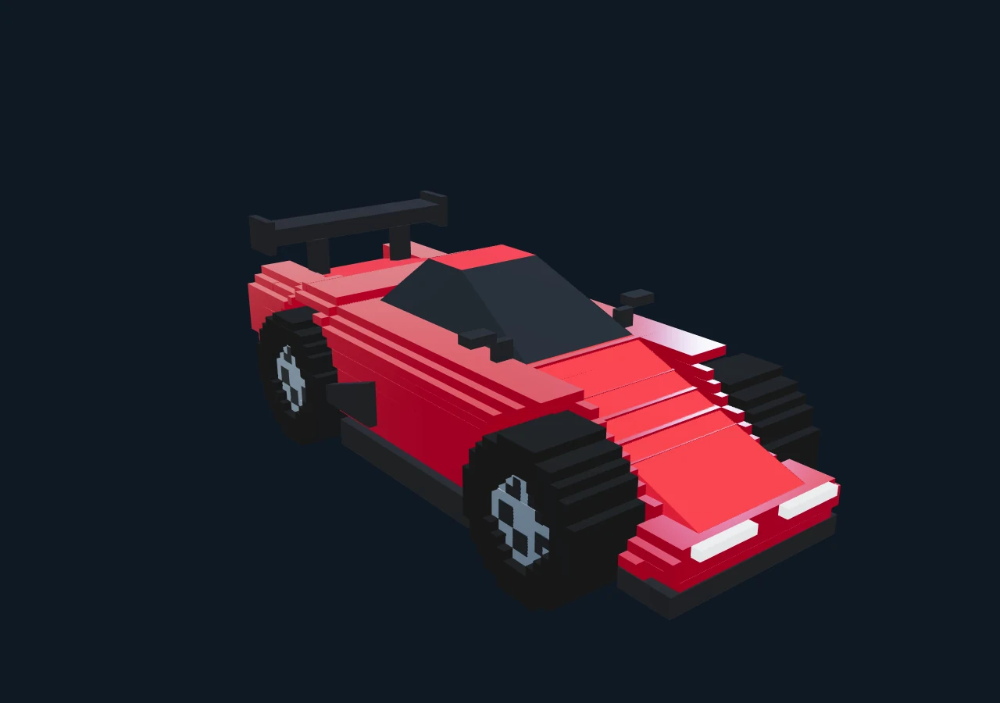
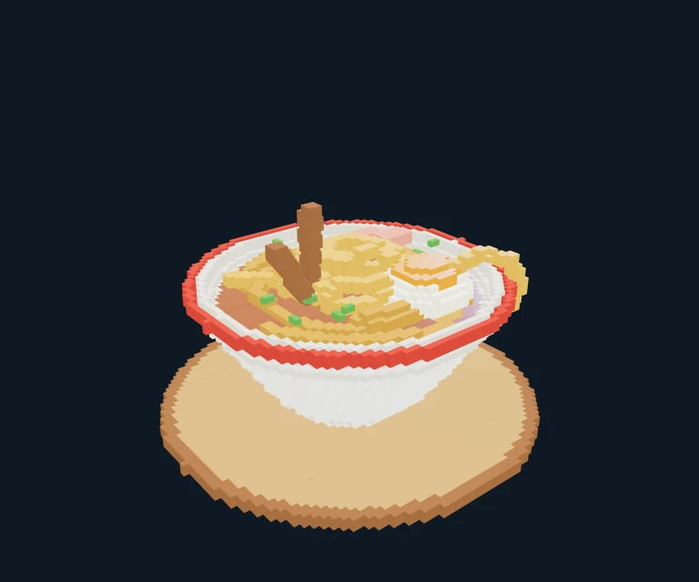
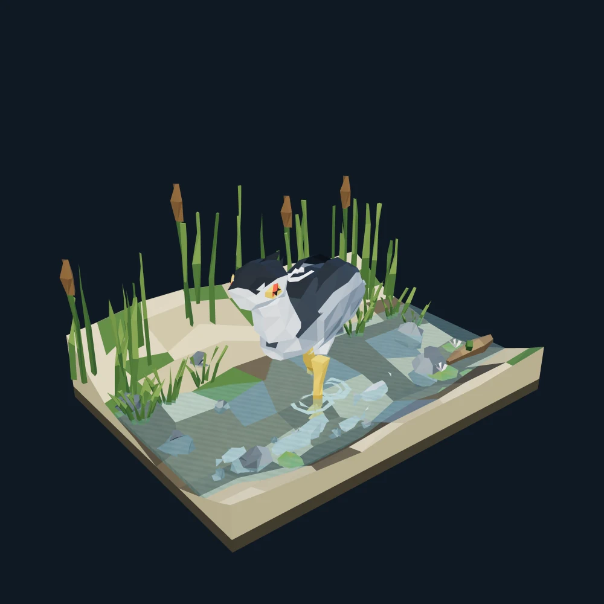
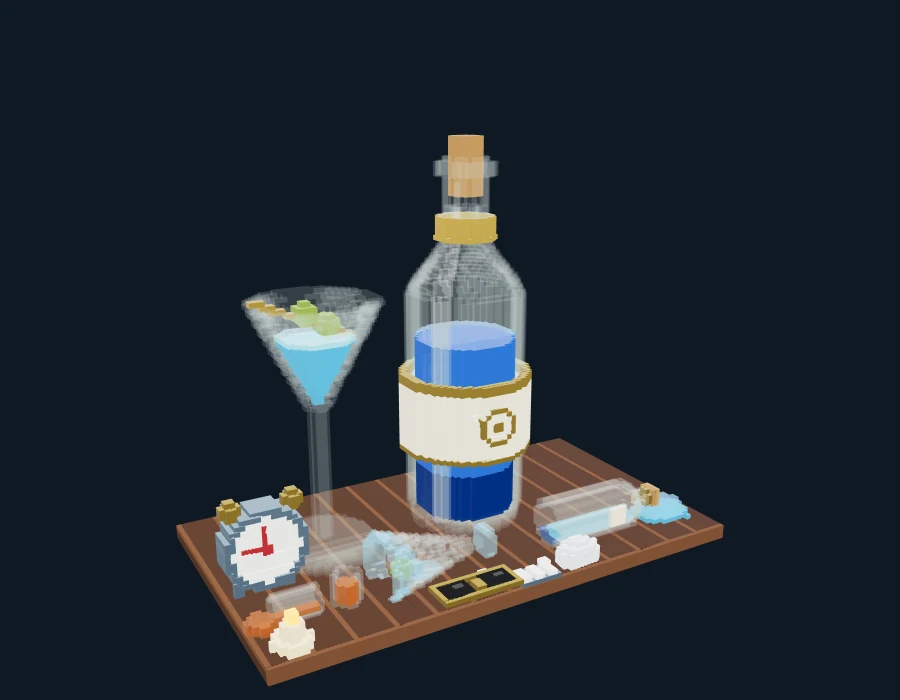
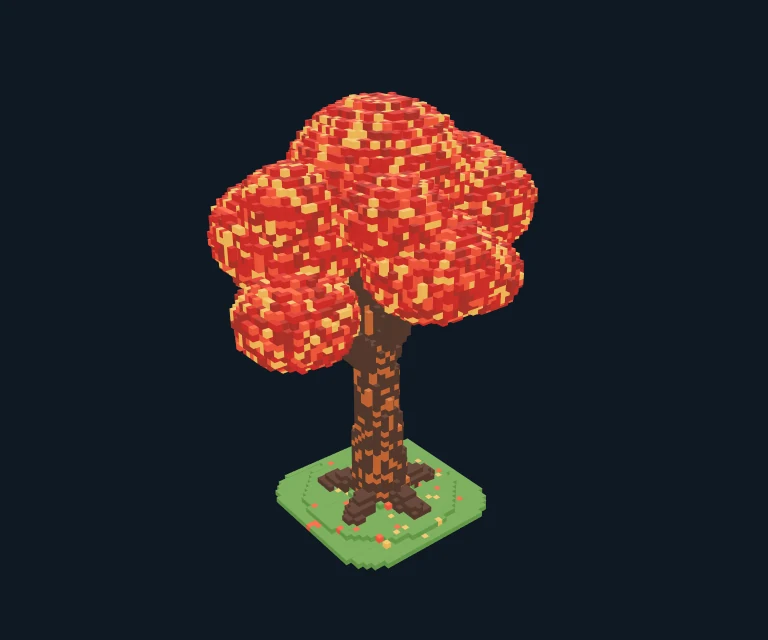
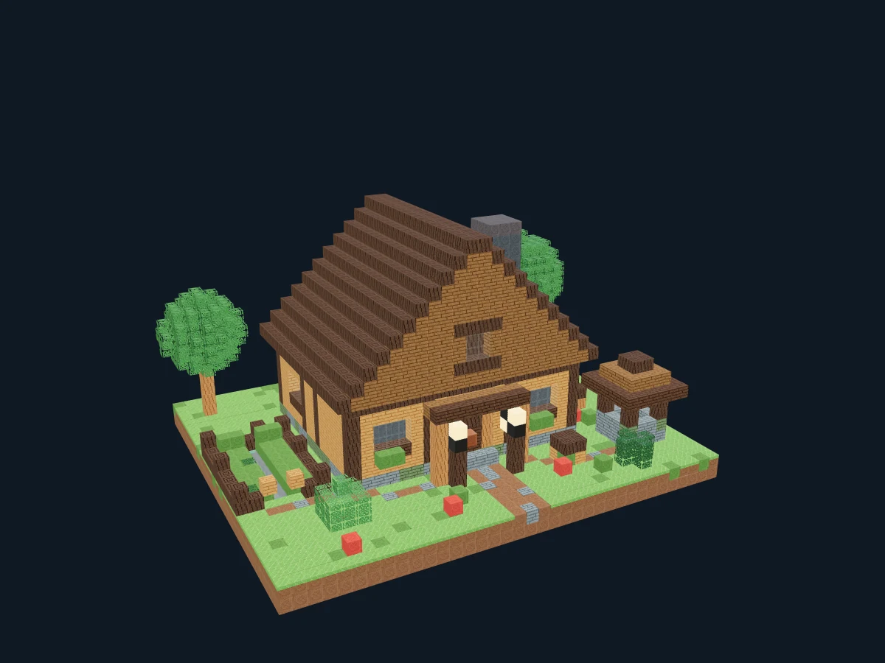
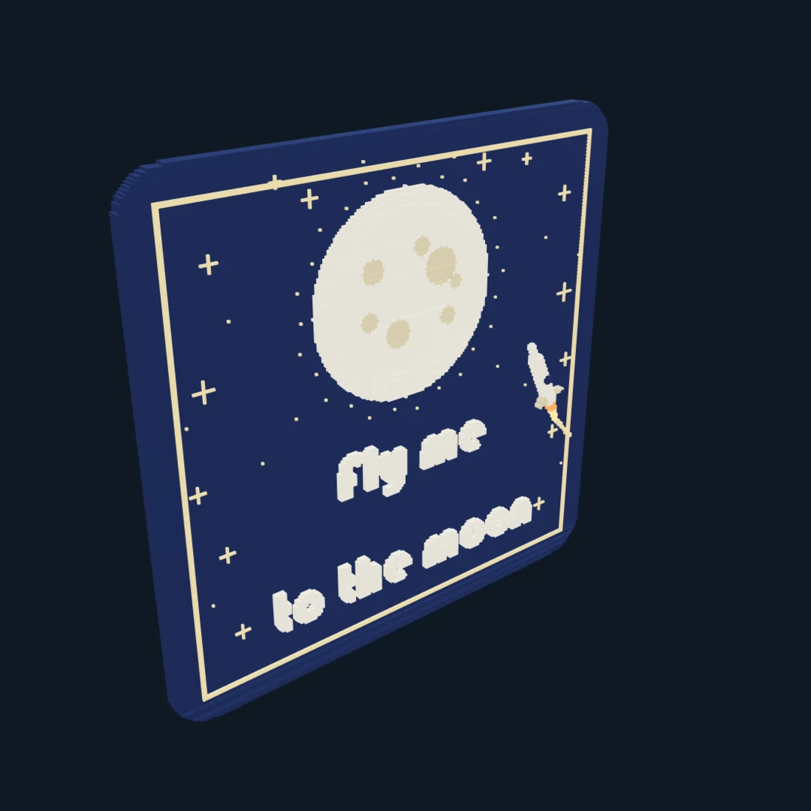

# MorphForge / 造形工坊

把一句话、一张参考图或一个想法，做成可以继续编辑的体素与低多边形作品。

MorphForge 是独立的桌面创作工作台：手工编辑、AI Harness、作品库和多视角预览共用一个前端，使用 Tauri + Rust。也可以通过 OSC，把作品逐步搭建到 VRChat Avatar 身边。

**[下载 Windows v0.16.0](https://github.com/chiro2001/MorphForge/releases/tag/v0.16.0)** · [使用指南](docs/USER-GUIDE.md) · [版本与验证记录](docs/DELIVERY.md)

## 作品展示

以下画面取自主程序个人作品库中已保存作品的实际渲染，涵盖体素场景、体素与三角面混合建模，以及低多边形作品。图片经过 WebP 压缩，保留原来的取景和内容。

| 不想上班：被窝防御工事 | 红色中置超跑 |
| :---: | :---: |
|  |  |
| 1,375 Box · 场景与体素文字 | 258 Box + 298 三角面 · 混合建模 |
| **一碗泡面** | **夜鹭水畔** |
|  |  |
| 1,908 Box · 食物与曲面细节 | 1 Box + 3,597 三角面 · 低多边形场景 |

<details>
<summary>更多作品：静物、树木、建筑与文字海报</summary>

| 宿醉 · 深夜之后的一桌 | 秋日枫树 |
| :---: | :---: |
|  |  |
| 1,503 Box | 13,451 Box |
| **方块风经典村民小屋** | **Fly me to the moon** |
|  |  |
| 622 Box · 方块建筑与像素材质 | 669 Box · 体素文字与海报 |

</details>

Box 是可以合并的长方体，数量与实际占用格数不同。展示作品来自个人作品库；安装包自带示例以[内置作品清单](examples/ATTRIBUTION.md)为准。配图来源与几何统计保存在[展示图记录](docs/media/showcase/README.md)。

## 可以做什么

| 功能 | 使用方式 |
| --- | --- |
| AI 创作与持续改稿 | 输入描述、选择参考图，按体素／多面体／混合风格建模；可指定尺寸，也可交给模型决定。支持插话、打断、暂停恢复和上下文 compact。 |
| 手工编辑 | 放置、擦除和切割长方体，编辑三角面与斜面；按分组移动、旋转、换材质，支持撤销重做、整体居中和保护选区。 |
| 观察生成过程 | 查看上游返回的思考内容、正文、工具操作与截图；通过创作时间轴回看历史版本。 |
| 参考图与体素文字 | 并排或叠加对照参考图，自由选择截图角度；读取图片像素、生成体素平面，或把字体文字栅格化为可编辑方块。 |
| 作品与组件复用 | 保存、载入和删除个人作品，从已有选区创建组件；多实例共享作品库，各自保留工程和对话。 |
| 材质与 Minecraft 导入 | 使用纯色、金属、发光、水、云及像素材质；导入 Java 资源包和 `.litematic`、`.schem`、`.schematic`、结构 `.nbt` 建筑。 |
| 动画与模型导出 | 为分组设置关键帧、播放与截图；导出 GLB、OBJ ZIP、PLY、STL，GLB 可保留分组动画。 |

## 快速开始

1. 从 [Release](https://github.com/chiro2001/MorphForge/releases/tag/v0.16.0) 安装 Windows x64 版本，打开程序后新建项目，或从作品库载入示例。
2. 在「设置」中配置 API 地址、模型和 Key。支持 DeepSeek 官方接口，以及兼容的 **Chat Completions / Responses** 服务；兼容接口使用内嵌图片，无需专用图片上传通道。
3. 在输入区选择建模类型、目标尺寸和参考图，使用快速草图／标准创作／精细作品预设开始创作。也可以直接手工编辑。
4. 观察截图并继续修改，完成后保存到作品库或导出。连接 VRChat 是可选步骤。

默认上下文上限为 **1M Token**、每步输出上限为 **384K Token**，实际请求按上游能力、剩余上下文及运行预算裁剪。输入区显示上下文占用、Token 用量与上游报告的 Prefix 命中率；工具和提示词优先中文。配置与预算说明见[兼容 API、预设和 Goal](docs/PROVIDERS-PRESETS-GOALS.md)。

## 在 VRChat 中展示

把工作台里的作品变成随身摆件、像素画框或建筑沙盘。朋友可以看着作品逐步搭起来，你也可以继续输入需求或手工修改，再发布更新。

- **现场搭建**：草稿编辑与网络发送并行，自动比较增量、清空重建、连续区域编码和同材质合并的发包成本。
- **摆放与抓取**：使用金色定位球移动整体作品，选择世界固定／跟随 Avatar、保持水平和缩放；光球显示时可用手势抓放。
- **切换与补播**：读取 Avatar 能力参数匹配协议和材质目录，使用作品库切换内容，通过周期或连续补播帮助晚加入者和漏帧恢复。

可导入[独立 Avatar 插件](dist/avatar/MorphForgeAvatar-1.0.0.unitypackage)，在 Unity 的 `Tools > MorphForge Avatar > 安装与检查` 一键安装到自己的模型；需要 Modular Avatar，可选 VRCFury 压缩服装等菜单参数。安装与材质目录说明见[插件使用文档](Assets/MorphForgeAvatar/README.md)。

发布需要已配置 MorphForge 显示模块的 **PC/PCVR Avatar**。在工作台识别并匹配目录后，选择 `VRChat 9000` 开启发送；多个窗口中只有一个可以占用 OSC。

<details>
<summary>查看 VRChat 实际画面</summary>

以下为用户提供的客户端截图：画框与跑车由 MorphForge 展示，背景属于所在的 VRChat 世界。


</details>

### 发布规格与边界

| 项目 | 当前支持 |
| --- | --- |
| 协议与空间 | MF6，240 bit 几何通道；独立插件默认定位 13 bit（旧配套 Avatar 为 14 bit）；`256³` 逻辑空间，配置容量 16,384 个 Box／三角面。 |
| 发送与恢复 | 0.10／0.20／0.25／0.28／0.30／0.40／0.50 秒档，支持保留显示的补播；进度条表示本机 UDP 写出。 |
| 颜色与贴图 | 新纯色、量化 PBR 和程序材质可实时发送；新的图片贴图需要重新构建 Avatar。 |
| Minecraft 材质 | 公开程序包含原创像素资源，也支持导入用户资源包。私人配套 Avatar 已验证原版 1.21.1 材质；原版 PNG/JAR 不随公开安装包分发。 |
| 建筑格精度 | 自动按形状与目标空间选择精度，完整方块可按 1:1 导入；薄结构近似、越界与容量问题会进入预览报告。 |
| 动画与碰撞 | 编辑器及 GLB 支持分组动画；当前 Avatar 发布静态几何，未实现可交互碰撞。 |

多人同步仍可能漏帧，**本机发包完成不能确认其他玩家已经完整显示**。当前面向 Very Poor 性能等级；16,384 是配置容量，本轮最终 worker 尚未重新完成完整16K长时验收。材质、带宽预算和真实验证范围见[MF6 发布与材质说明](docs/stream-v16/RESULTS.md)。

## 文档与开发

- [Avatar 插件与透明度验证](docs/avatar-plugin/README.md) · [插件安装说明](Assets/MorphForgeAvatar/README.md)
- [使用指南](docs/USER-GUIDE.md) · [参考图用法与来源](docs/references/README.md) · [创作工具说明](docs/HARNESS-QUALITY-TOOLS.md)
- [参考对照、组件与动画 API](docs/creative-v15/API.md) · [版本记录](docs/DELIVERY.md) · [0.16 正式安装与验证](docs/release-v16/RESULTS.md)
- [源码与克隆](docs/GIT-SOURCE.md) · [Windows 桌面构建](desktop/README.md) · [Unity 操作规范](UNITY-GUIDE.md) · [历史原型](docs/history/README-stage1-3.md)

Rust 核心可以独立运行：

```bash
./tools/cargo_local.sh test --workspace
./tools/cargo_local.sh run -p morphforge-app -- serve --data /tmp/morphforge-dev --port 8766
```

Unity 构建与验证使用 **2022.3.22f1** 及 Pipeline。仓库提供构建脚本和协议实现；人物模型、商业资产及生成的完整 Avatar 保留在用户本机，不随源码或安装包分发。
