# MorphForge / 造形工坊

独立体素艺术工作台：手工编辑、兼容 API 的 AI 创作、作品库与多视角预览共用一个前端，Rust 核心可独立运行在 Windows。VRChat Avatar 是可选发布目标，不是创作和保存作品的前置条件。

- [用户指南](docs/USER-GUIDE.md)：安装、配置、编辑、AI、compact、作品库与 OSC 发布。
- [交付记录](docs/DELIVERY.md) · [实施状态及证据](docs/plan/STATUS.md) · [已确认设计](docs/plan/README.md) · [验收标准](docs/plan/ACCEPTANCE.md)。
- gamepc 开发测试副本 **0.15.3**：明确增量基准为本机逐条已发记录，修复跨池删除历史丢失和MF6手动补播被拒绝；输入区显示当前上下文k数/窗口/百分比，保留严格前缀检查。仍无多人接收ACK。[修复与验证](docs/publish-context-v15.3/RESULTS.md)。
- gamepc 开发测试副本 **0.15.2**：开放0.10/0.20/0.25/0.28/0.30/0.40/0.50秒发送档位，修复快速切档被旧刷新覆盖；预览增加三角面深度优先级。Avatar着色器修正已通过Unity GPU测试，需重新上传头像才能在VRChat生效，本轮未上传。[修复与验证](docs/overlap-v15.2/RESULTS.md)。
- gamepc 开发测试副本 **0.15.1**：修复大上下文流式暂停后无法继续；中断未结算单独记为费用未知，不再误报缓存失效，严格前缀保护保留。主安装继续保留0.15.0。[修复与验证](docs/pause-resume-v15.1/RESULTS.md)。
- gamepc 主安装 **0.15.0**：参考图并排/叠加对照与相机书签、Harness可复用组件、分组关键帧/播放/姿态截图及动画GLB导出。新增可直接播放的风车示例；动画目前用于编辑器与GLB。[使用与验证](docs/creative-v15/RESULTS.md)。
- gamepc 开发测试副本 **0.14.1**：补测GUI按钮，修复设置/弹窗提示不可见、上下文面板消失及变换/换材质后选区丢失。[按钮验收记录](docs/gui-buttons/RESULTS.md)。
- gamepc 开发测试副本 **0.14.0**：右侧按创作过程展示思考、正文、工具摘要和截图，修复滚动跟随与中文历史分页；新增文件/编辑等桌面菜单，以及GLB、OBJ ZIP、PLY、STL导出。[使用与验证](docs/studio-v14/RESULTS.md)。
- gamepc 开发测试副本 **0.13.0**：MF6 统一240bit帧、三角面与单对象体素斜面、历史删除补播、Minecraft建筑源库／资源包状态／独立预览／可撤销导入。MF6 16K配套头像已上传并通过三项服务端分析，尚未真实多人验收。[分阶段计划](docs/mf6/PLAN.md) · [验证记录](docs/mf6/RESULTS.md)。
- gamepc 开发测试副本 **0.10.0**：读取参考图像素、缩放副本、图片转彩色体素平面、连续循环补播和三种发送顺序；兼容MF5 v15、新1%～1000%缩放、实时材质与48种原创纹理。原安装与数据保留，未新增Release。[本轮功能与可行性](docs/image-stream/DESIGN.md) · [验证](docs/image-stream/RESULTS.md)。
- Windows **0.6.0 候选版**：`dist/windows/MorphForge Desktop_0.6.0_x64-setup.exe`；校验和在同目录。[Harness强化验证](docs/quality-v6/RESULTS.md) · [前缀缓存修复](docs/quality-v4.2/RESULTS.md) · [参考图建模迭代](docs/quality-v4.1/RESULTS.md)。

GitHub公开仓库：`chiro2001/MorphForge`，默认分支`main`，开发分支与完整历史保留。
[获取源码和Windows克隆验证](docs/GIT-SOURCE.md)。

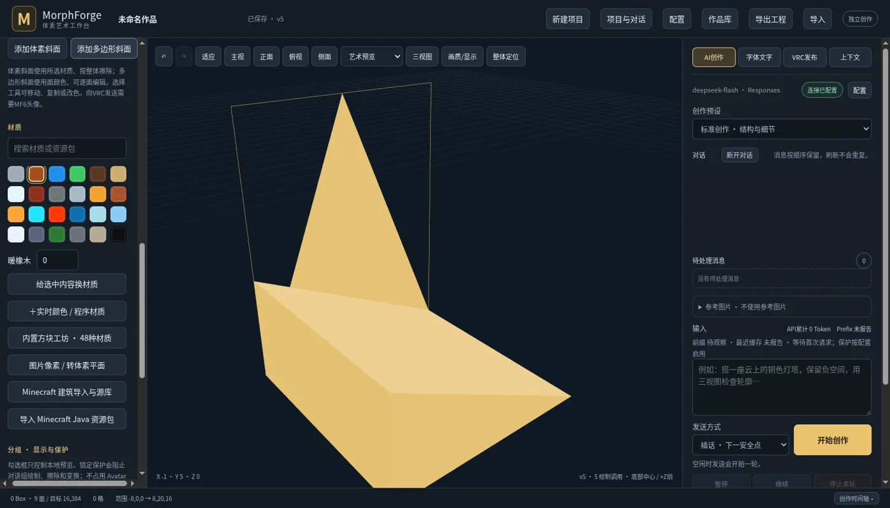

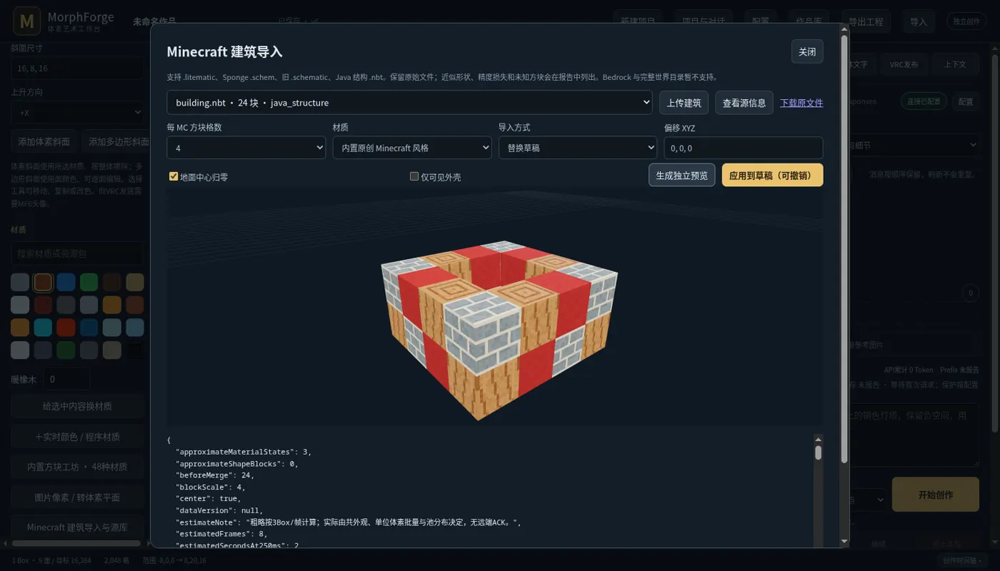

## VRChat 实际画面

以下为2026-10-21的实际客户端截图，由用户提供。画框与跑车是MorphForge展示内容，背景庭院和建筑属于所在VRChat世界；截图展示当前效果，不表示所有玩家的同步完整性已经验收。图片保留3840×2160分辨率，使用高质量WebP压缩，原始PNG不变。

像素画框：

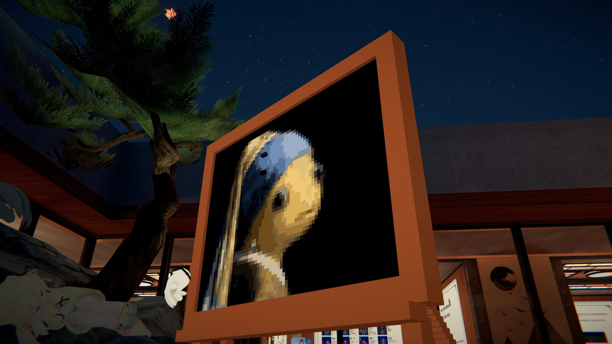

跑车作品：

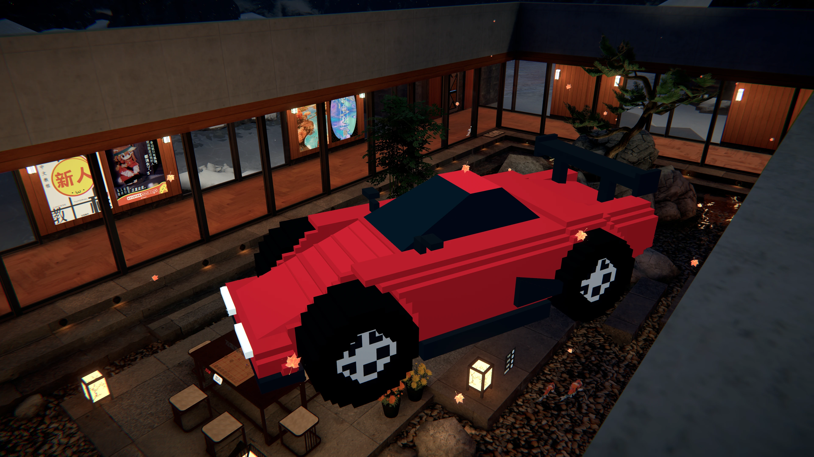

## 在 VRChat 中的预期体验

把 Avatar 变成一个随身的体素创作台：在电脑端输入文字、提供参考图或手工编辑，通过 OSC 把作品逐步呈现在身边。目标是让同房间的朋友一起看着建筑、雕像和文字搭起来，再根据聊天中的新想法继续修改。体素内容由 Avatar 显示，作品和创作上下文长期保存在外部工作台。

| 功能与玩法 | 怎么操作 | 房间内的预期效果 |
|---|---|---|
| AI 现场搭建 | 输入“搭一座有拱门和发光招牌的小屋”，按阶段发布 | 墙体、屋顶和装饰逐渐出现；AI 可在后台继续设计 |
| 看图做摆件 | 选择图库或上传参考图，生成角色、建筑或道具 | 把参考图的轮廓、配色和识别点近似为立体体素作品 |
| 朋友出题、持续改稿 | 接着输入“加条鲸尾”“把屋顶换成蓝色”，或中途插话 | 在已有作品上增删、擦除和换色，保留连续上下文 |
| 手工积木与沙盘 | 在共享编辑器中绘制长方体、挖洞、选择分组和调整位置 | 演示搭桥、修楼、挖门窗，也可手工修正 AI 作品 |
| 随身展示与房间摆放 | 用底部中心的金色定位球定位，切换世界固定/跟随 Avatar、缩放及保持水平 | 做桌面小摆件、身边的展示牌，或放大成场景沙盘；手势抓放用于搬动整体作品 |
| 立体文字 | 选择字体，把短句、名字或标语生成体素 | 展示由真实方块组成的招牌、祝福语和纪念牌 |
| 材质与作品切换 | 使用已打包的材质目录，加载作品库中的不同作品并发布 | 展示木石、金属、发光、云水表面或 Minecraft 风格；重复调用已有作品无需重新生成 |

例如，可以让朋友轮流出题做一个“房间吉祥物”，边看生成边提修改意见；也可以先准备一组建筑和雕像，现场切换成小展览。手工编辑与 AI 共用同一份作品，适合先让 AI 搭主体，再由操作者补细节。

一轮演示的操作顺序：

1. 切换到包含 MorphForge 模块的 Avatar，启用 VRChat OSC；工作台选择 `VRChat 9000`。
2. 在工作台选择参考图并输入需求，先查看草稿；开启发送后，手动发布当前版本，或启用“编辑后自动发布”。
3. 观察作品按发送进度搭建，继续输入需求或手工修改；定位球控制整体摆放、跟随模式和大小。
4. 保存到作品库，按需再次发布；需要恢复显示时使用“清空并重建”，也可配置周期全量刷新。

### 显示效果与当前边界

- **空间与精度**：VRC 适配器使用 `256³` 逻辑空间，当前容量目标为 **16,384 Box**。Box 是长方体，一整片连续墙体可以合并成一个 Box；容量消耗取决于几何碎片和外观分区。逻辑格长 `0.25m`；MF5把旧5%重定义为新100%，支持 **1%～1000%**（实际scale `.0005～.5`，单格0.125～125毫米），旧作品保持实际尺寸。
- **搭建节奏**：AI 在本机快速编辑草稿，网络队列按节拍发送已发布修改，两者可以并行。大作品首次搭建需要等待；优先用合并长方体减少命令量，现场演示适合先搭大形、再补细节。
- **多人观看与恢复**：创作者运行工作台，其他玩家通过 Avatar 参数同步观看；已有本人及其他玩家可见的现场反馈，但仍存在漏帧。MF6支持保留显示的周期/连续补播，“清空并重建”为单独操作；晚加入者需要等待完整补播。发送间隔提供七档，本机ACK不能确认远端接收，发送完成也不能证明所有玩家都已显示完整。
- **外观与动画**：已有六面贴图、材质帧动画、金属/发光及云水表面表现。新 RGB 色板或资源包需先导出并更新 Avatar 材质目录，才能在 VRC 中对应显示。逐 Box 实体运动、骨骼动画和复杂物理属于后续扩展。
- **适配与验收**：当前面向 PC/PCVR、Very Poor 性能等级。几何、定位约束、容量和材质已有 Unity 原生验证；配套MF6 16K包有服务端检查与用户客户端显示反馈。多人完整同步仍有漏帧，VR硬件抓放等项目需要继续验收。上表描述目标体验，实测范围以[验收记录](docs/plan/ACCEPTANCE.md)及[当前已知问题](docs/overlap-v15.2/RESULTS.md)为准。

## 工作台与已有作品

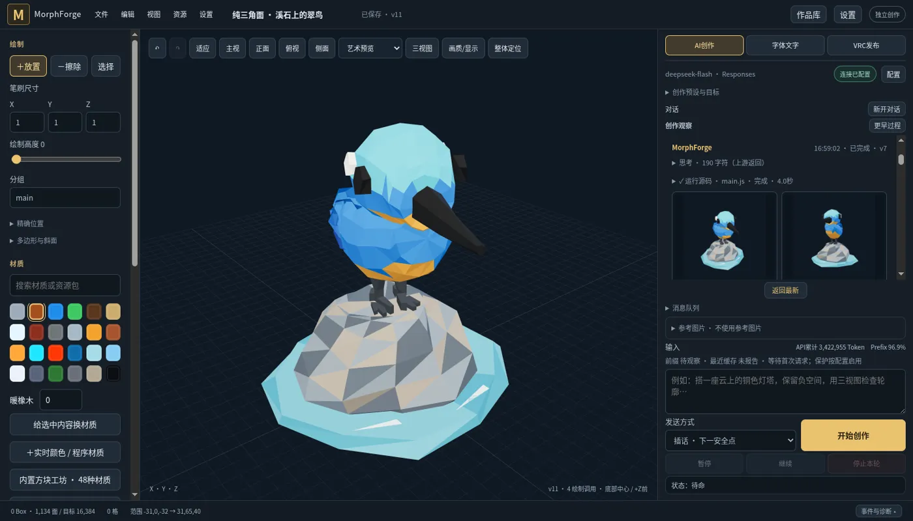

连接与运行配置集中在独立页面：

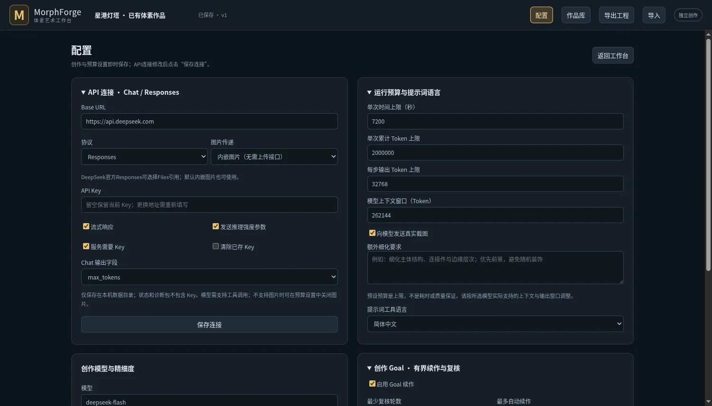

| 云上邮局 | 星港灯塔 |
|---|---|
| 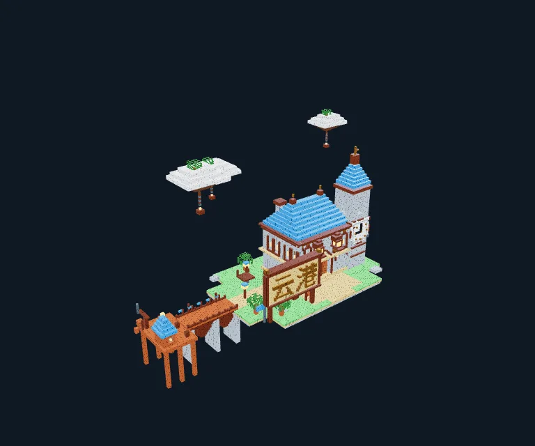 | 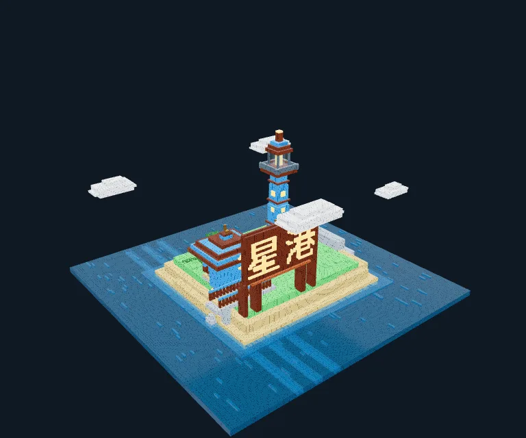 |

工作台截图为0.14界面载入真实模型生成的翠鸟，并离线回看创作过程；下方为此前真实 DeepSeek 创作的渲染，包含由字体栅格化的可编辑体素汉字。作品过程、失败与修正见 [Harness 迭代记录](docs/harness-v2/evals/README.md)。展示图为压缩 WebP 副本，原始验收 PNG 保留。

作品库已离线内置7个完整示例：铜灯塔与树（49 Box）、Leviathan灯塔（7,459）、云港驿站（766）、星砂港（791）、鲸鱼娘（223）、木椅（16），以及带组件和循环动画的风车（32 Box / 2面）。点击“载入可编辑副本”即可继续手工或AI修改；几何、材质与21张真实视图随程序附带，无需重新生成或覆盖示例原件。[示例署名与许可](examples/ATTRIBUTION.md)。

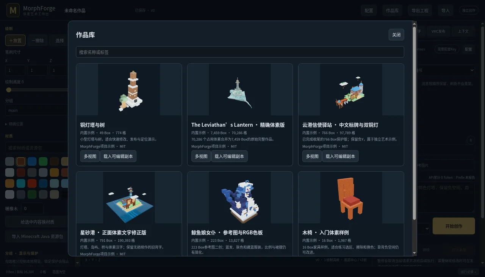

## 创作时间轴与强化工具

底部「创作时间轴」可查看上游实际返回的思考文本/摘要、工具参数与代码、截图、用量、暂停和错误；支持按运行筛选、历史分页和只读3D版本回看。查看记录不调用模型、不修改当前工程。

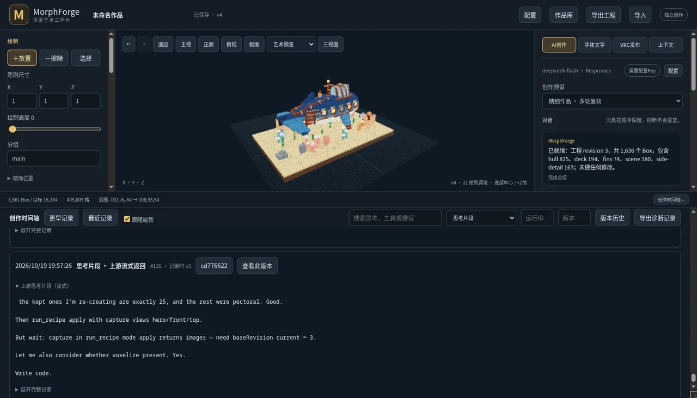

图为真实模型实验记录的离线回放；包括真实失败，运行时修复与验收见本轮报告。

新增自由/局部/正交相机、曲面/管线/挤出助手、持久CommonJS源码与精确patch，以及绘制后直接返回截图。缓存与前缀常驻检查：官方接口默认严格，兼容服务可在配置页选择「严格」；异常和执行器崩溃会暂停后续调用。严格模式预留预计输入预算，不把缓存命中率当作没有费用。[工具与用法](docs/HARNESS-QUALITY-TOOLS.md)。

真实生成实验的失败、Token消耗和修复均保留；尚未完成与用户dsh的同条件配对，不能宣称质量已追平或超过。

## 参考对照、组件和动画

“参考对照”可选择图库图片并排或半透明叠加，调整裁剪/缩放/偏移，保存相机书签并生成对照截图。组件库从已有选区或分组保存几何，支持整数倍缩放、四向旋转、镜像与批量放置；Harness在同一对话中可保存一次再反复调用，组件随项目保留。

动画面板为已有分组设置枢轴和移动/旋转/缩放关键帧，支持播放、循环、拖动与冻结姿态截图，可导出带运动的GLB。作品库载入“会转动的风车”，打开动画选择“风车匀速转动”即可尝试；返回静态编辑后继续建模。当前MF6 Avatar仍发布静态几何；编辑器播放不发送逐帧OSC。[接口与边界](docs/creative-v15/API.md)。

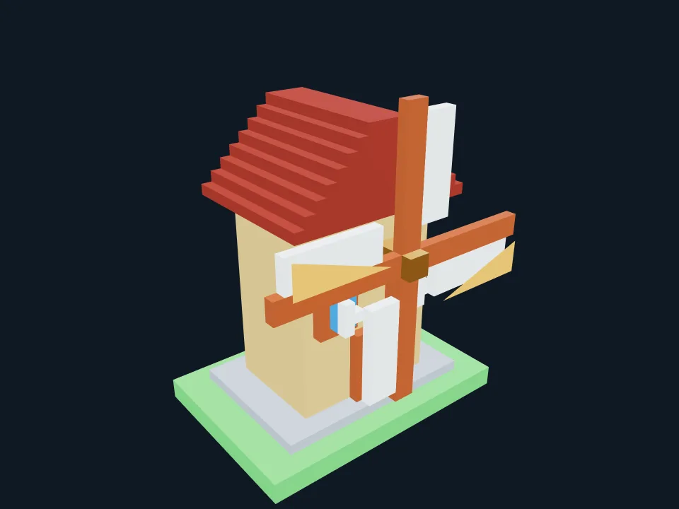

## 图片参考

支持从内置图库或本次添加的图片生成体素，可分别关闭或组合使用，最多6张。内置5张项目自制结构参考与3张核实出处的鲸鱼娘参考，附作者、原帖和独立许可；个人图片留在本机图库，发送选中参考时才交给模型。续作和compact保留参考，取消后下一次输入更新，Harness作品记录来源。

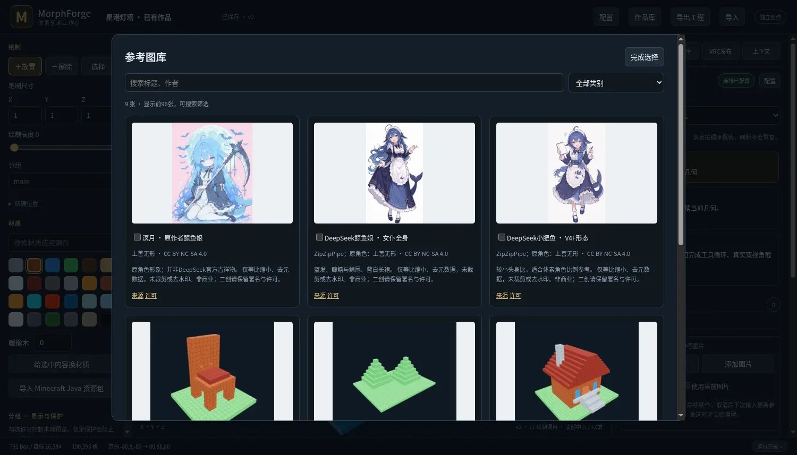

[用法、素材出处与许可](docs/references/README.md)。复杂角色的比例、遮挡与配色仍需人工复核，参考图片不等于自动重建保证。

已支持精确RGB色板，缺少颜色时由模型创建并保存。普通请求只追加内容，system保持稳定，旧截图清理移到compact边界。下面是2026-10-20使用真实DeepSeek-V4.1-Flash看图生成的红顶小屋：184 Box，包含截图后的实际几何修改和自动保存。参考图为项目原创；最终截图来自工作台实际渲染。

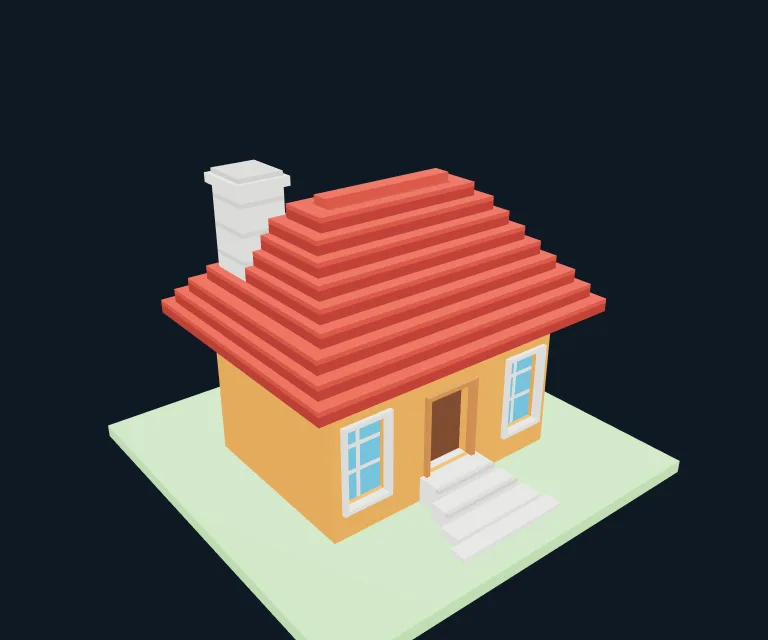

放宽评测预算后，小屋新增12个模型响应、约105万累计Token，上游实际输入缓存命中96.94%，已自动复核、提交并保存，全部评测项通过。屋顶、烟囱和门窗比例仍是近似。[预算扩展后的验证记录](docs/mf6-real/expanded-budget/RESULTS.md) · [可导入作品JSON](docs/mf6-real/expanded-budget/reference/artwork.json) · [首轮预算不足的原始记录](docs/mf6-real/RESULTS.md)。

同轮还验证了[纯三角面翠鸟](docs/mf6-real/expanded-budget/RESULTS.md)：续作最终1,134面、0 Box，模型自动复核并保存；实际输入缓存命中98.36%，开放边、非流形边、退化面与共享边绕序冲突均为0。作品仍由多个闭合壳体构成，未做布尔并集；首轮失败与续作的实际记录均保留。

## 创作速度与精度

AI创作支持 **快速草图／标准创作／精细作品** 三档 preset，分别偏向轮廓速度、结构与细节平衡、多阶段细化。预设同时设置中英提示词和默认预算，仍可手动调整。精细档默认启用有界 Goal 续作，要求不同几何的真实截图复核；支持插话、打断、暂停和 compact。耗时和质量仍取决于任务及所选模型。

连接、预算和Goal等设置集中在独立配置页；输入框旁显示API累计Token、本轮Token和加权Prefix缓存命中率，上游未报告时明确标记。

默认上下文开放到 **1M（1,048,576）Token**，每步输出上限 **384K（393,216）Token**，三档预设共用这两个容量上限。运行时读取上游`/models`能力，并按较小的模型限制、上下文剩余空间及运行预算裁剪实际输出；完整窗口中的输入与输出不能相加超过模型上限。仍匹配旧默认值的配置自动升级，自定义数值保留。

API连接可自定义 **Chat Completions 或 Responses** 服务、Base URL、模型名和 Key。非DeepSeek官方接口强制内嵌截图，无需图片上传或 file_id 接口；文本模型可关闭图片。连接与作品库独立于 VRC，可作为体素生成器、浏览器和编辑器使用。配置方法、三档预算与验证范围见 [使用说明](docs/PROVIDERS-PRESETS-GOALS.md)。

## 当前实现

共享工作台支持稀疏 Box 几何、精确切割、分组变换、撤销重做、版本快照和资源包材质。Harness 提供受限 Recipe、多视角截图、工具调用循环、插话、打断续接、排队、暂停恢复、详细日志和上下文 compact；compact 保留原始日志、图片、Recipe 与作品版本。提示词与工具说明优先中文，并提供英文版本。字体文字栅格化为普通可编辑 Box，支持预览与撤销；保护分组可锁住既有作品。真实 DeepSeek 多轮创作、交互、compact 和收尾入库已验证，失败与接续修正记录一并保留。

独立作品库已有铜灯塔及其续写版本，以及旧完整场景的精确转换：70,286 个实际占用体素无损合并为 7,459 Box。Minecraft Java 资源包支持常见整立方体、六面与动画纹理；当前云、水、金属等使用体素表面材质表现。

当前无面捕主档为 **MF5：240 bit 三路几何 + 14 bit 定位，共254 bit**。三路各有主/次独立粒子池，总逻辑容量16,384 Box。0.25秒间隔下理论最高12个长方体/s，同外观单位体素可成对发送，最高24块/s。配套头像为 **MorphForge MF5 16K**；本体衣装/道具自定义参数仅本地使用。[MF5协议与边界](docs/mf5/DESIGN.md)。

**颜色与常见材质实时生成**：`define_palette` / `define_materials` 可随绘制发送RGB24纯色、量化PBR和程序水/云/木/石，无需每新增颜色都重传头像。配套头像内置48种原创MIT的Minecraft风格方块纹理，可直接选择、实时染色，作品材质ID不同也能映射。任意新图片仍需重新打包；运行时透明材质暂不带内部面遮罩。编辑器可对比艺术原值与VRC量化结果，5000种同表面纯色使用实例合批。原MF4目录与旧19种像素主题保留兼容入口。

历史面捕兼容档为 **MF3：56 bit 几何通道 + 14 bit 定位**。完整面捕固定预留 **161 bit**，其余本体功能和压缩承载预算 **25 bit**。MA 注入几何和定位模块，VRCFury 负责完整面捕及低频参数压缩；实际SDK联合构建已通过256/256bit，FT161与MF70全部直通；通过精简本体同步实现，无压缩carrier。最终 prefab、上传场景及生成入口均已排除睡眠插件依赖。已通过补发到达 16,384 个唯一 Box 及满池回收验证。显示池持久保存每个 Box 的位置、尺寸和外观编码，接收动画器保持固定规模，不为每个 Box 创建一组状态；真实 UDP 首遍缺失、最终材质及 FullFT 联合构建结果见实施状态。

默认回归只向9012发送，不向9000发包或启动VRChat。2026-10-19经用户明确授权，已上传并核验私有 **MorphForge FullFT 16K**：实际包总256bit、完整FT161、Store16384，服务端三项分析均200。修复了Catalog metadata布局、FullFT场景根名和人物特效Pickup碰撞力；[最终证据](docs/security-check-failure/FINAL-FULLFT.md)与[客户端复核步骤](docs/security-check-failure/CLIENT-RETEST.md)。

网络发布没有远端ACK；本机发送进度不能证明其他玩家已经显示。真实客户端加载、多人及VR手势仍待现场确认。当前主安装为0.15.0；公开Release按用户要求另行发布。

## 开发入口

```bash
./tools/cargo_local.sh test --workspace
./tools/cargo_local.sh run -p morphforge-app -- serve --data /tmp/morphforge-dev --port 8766
```

Windows 打包入口为 `desktop/`，见 [桌面说明](desktop/README.md)。Unity 资源通过 [Unity 操作规范](UNITY-GUIDE.md) 和 Pipeline 构建，禁止手改序列化资产。

## Unity 工程

- Windows：`D:\Projects\VRChatProjects2\MorphForge`
- Unity：2022.3.22f1；通过 `tools/unity_remote.py` 显式选择工程。
- FullFT：`Assets/MorphForge/FullFT/Avatar.prefab` 与 `Assets/MorphForge/FullFT/MorphForge_FullFT.unity`；实际预算与API烟测见 [FullFT验收](docs/fullft/README.md)。
- Nemesis 商业资产和生成的完整 Avatar 只保留在用户 Windows 工程中。

## 历史原型

[Stage1–3 历史入口与环境配置](docs/history/README-stage1-3.md) 保留原型、依赖和旧验证链接。旧的 64 Box、MF2/88 bit、Python 8765 编辑器与基础 Avatar 预算均不是当前产品规格。
