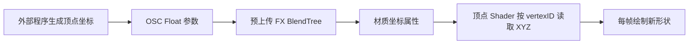

# 当前原理与 0.2 秒同步周期下的能力估算

日期：2026-10-18。本文将 0.2 秒作为“远端能够稳定接收一批新状态”的规划假设，给出网络侧理想上界；不是吞吐或可靠性实测。原始计算见 [estimates.json](estimates.json)。

## 当前原理

当前载体有 24 个独立顶点、8 个三角形，CPU 顶点均为零。外部写入 72 个坐标，Shader 将第 i 个顶点的绘制位置设为 V[3i]、V[3i+1]、V[3i+2]；超过有效三角形数的部分退化为零面积。

FX 使用常量动画端点和 BlendTree 插值，把各参数数值送到材质属性。具体形状由本次外部输入决定。已有 39 项 Editor 检查，包括三组 GPU / CPU 参考图相等、载体资产哈希不变，见 [原型记录](../probe14/README.md)。

所有 75 个探针参数目前 local-only；多人同步尚未实现。当前 8 面是实验容量，不是平台的几何硬上限。它没有生成新的 Unity Mesh 资产、碰撞体或动画 Clip。

## 两段通道要分开

外部进程经本机 OSC 写入参数是一段；Avatar 参数传到其他玩家是另一段。不能把多人更新间隔当作本机 OSC 的硬性最小周期。

官方 Animator Parameters 文档描述 Playable 同步通常按变化在 0.1–1 秒更新，没有给出稳定 0.2 秒的交付保证。本文仍按用户提出的 0.2 秒假设计算。如果某些观察者每秒才收到一次，持续有效载荷就可能比表中少约五倍；如果地址/载荷不能正确配对，数值吞吐也不等于可用数据吞吐。

同步传递的是当前参数状态，不能预设它具有逐批有序、原子、可靠交付的消息语义。需要实际测试稳定保持时间、重复、乱序和晚加入恢复。本机 OSC 回读不代表所有观察者收到。

## 实际参数预算

2026-10-18 额外在临时 Avatar 副本上执行 MA/NDMF 处理，得到 [导出诊断](../probe14/export.json)：

| 项目 | 结果 |
| --- | ---: |
| 当前 Avatar 参数总数 | 104 |
| 其中本原型参数 | 75，全部不同步 |
| 原有同步状态预算 | 89 bit |
| 在 256 bit 总预算中剩余 | 167 bit |
| 75 个探针全部开启同步所需新增预算 | 593 bit |

因此不能直接把当前全部参数开启同步。593 的计算是 74 Float × 8 + 1 Bool。仅坐标部分也要 72 × 8 = 576 bit。

如果改为共享数据通道，假设为地址、版本和操作等预留 32 bit，那么余量可容纳 16 路 8-bit 载荷，总使用量为 89 + 32 + 128 = 249 bit。

这要求另外实现分页、状态保持和数值编码。不能把 Float 的 255 个远端状态简单当作 256 个字节值。官方支持 Expression 与 Animator 参数类型转换，可研究 Int 同步、Float 驱动 BlendTree 的组合，但需真实客户端验证；也可以采用更保守的 Float 离散编码。

## 理想有效载荷

若有 C 条真正可用的 8-bit 通道，每批间隔为 T：

`有效载荷理想上界 = C / T 字节每秒`

| 载荷通道 | T=0.2 秒时的理想上界 | 条件 |
| --- | ---: | --- |
| 8 路 | 40 B/s | 另有协议状态预算 |
| 16 路 | 80 B/s | 可按当前 167 bit 余量作方案起点 |
| 24 路 | 120 B/s | 需要更多预算，当前原有功能保留时放不下 |
| 32 路 | 160 B/s | 用满 256 bit，未留协议状态或原 Avatar 功能，只有上界意义 |

这些是可承载的新信息估算，不是 UDP/OSC 数据包的线速。重复两次会大致减半净速率；若一个有效写入需要准备与提交两个周期，也会进一步降低。实际效率取决于协议设计，不能将所有开销一概当作已测得的固定倍率。

## 逐顶点传输的代价

按 16 字节有效载荷/批、0.2 秒/批，三角形各有三个独立顶点，只传 XYZ：

| 三角形数 | 8-bit 坐标数据量 / 理想时间 | 16-bit 坐标数据量 / 理想时间 |
| --- | --- | --- |
| 8 | 72 B / 1.0 秒 | 144 B / 1.8 秒 |
| 100 | 900 B / 11.4 秒 | 1,800 B / 22.6 秒 |
| 1,000 | 9,000 B / 112.6 秒 | 18,000 B / 225 秒 |
| 10,000 | 90,000 B / 18.75 分钟 | 180,000 B / 37.5 分钟 |

每个三角形需要 9 个坐标。时间按批次数向上取整。没有包含 UV、法线、颜色、重传、等待或初始化。这里的 8/16 bit 是待实现的编码格式，不是当前 local-only Float 自动具有的远端精度。

索引与共享顶点、量化和压缩可以改变数据量；相应解码能力也必须预先存在于 Avatar 中，不能假设拿现成任意网格压缩格式就可直接使用。

此通道不适合反复全量推送高模。静态模型可以慢慢积累；容量上限还取决于预分配存储、载体、Animator、Shader 与裁剪设计。当前逐标量一层 Animator、Shader 显式选择 72 个坐标的原型结构，不应直接按比例扩展到几万个顶点。

## 精度与尺度

直接同步 Float 的步长为 1/127，覆盖 -1–1 共 254 个间隔。若将它映射到跨度 L 米的坐标，坐标步长为 `L/254`。

| 单轴坐标跨度 | 直接同步 Float 的步长 | 两段编码为 14 bit 的理想步长 | 编码为 16 bit 的理想步长 |
| --- | ---: | ---: | ---: |
| 2 米 | 7.87 mm | 0.122 mm | 0.031 mm |
| 10 米 | 39.37 mm | 0.610 mm | 0.153 mm |
| 20 米 | 78.74 mm | 1.221 mm | 0.305 mm |

表中是量化台阶，不是最终视觉或物理精度；就近取整的最大纯量化误差约为半个台阶。多段编码会占用更多通道。物体中心和局部顶点分别编码，可避免让每个小物体的细节承担整个大场景的坐标范围。

## 更合适的建模表达

建议把常用形状改为局部生成，仅传能够编辑它的描述：

| 表达 | 传输内容 | 本地得到的结果 |
| --- | --- | --- |
| 参数化部件 | 类型、中心、尺寸、旋转和材质编号 | 盒体、柱体、屋顶等 |
| 拉伸 | 二维轮廓和高度 | 墙体、建筑外壳、台阶 |
| 曲线构件 | 控制点、半径、细分数量 | 管道、拱门、栏杆 |
| 阵列 / 种子 | 一个部件描述、间距、数量、随机种子 | 重复结构与分布 |
| 自由网格 | 量化顶点及可选拓扑 | 少量无法由常用生成器表达的形体 |

例如一条 24 字节的部件记录，在理想模型中两批、0.4 秒传完；解码器可用它控制很多预分配三角形。这只是数据表达优势，不代表目前已实现该生成器或已知其可用面数。

首版可将 16–32 个可编辑参数化部件作为实验目标，另留少量自由三角形；对象数与每对象细分上限由本机和远端性能实验确定，不预先承诺千面或万面已经可用。

## 对动画的含义

5 Hz 输入不要求以 5 FPS 绘制。可以发送目标变换、时长、轨迹控制点、振幅和周期，让 Shader 按每帧时钟计算中间形状。新的描述只在变化时传输。

如果每次都传当前 8 三角形载体的全部 16-bit 坐标，144 字节要 9 批，理想也需 1.8 秒；这不适合实时全顶点动画。局部程序化运动与关键状态插值更合适。

不同观察者的本地时钟和收包时间并不自动相同，多人同相运动还需起始相位、时间基准或周期纠偏设计。几何参数、动画参数和传输暂存数据应有独立的应用版本，避免半更新形状可见。

## 推荐下一步

先实现一个小型同步数据实验，测量 0.2 / 0.4 / 1.0 秒保持时间下可正确接收的页率、量化错误和恢复耗时；据此确定净载荷。再增加参数化部件生成器，不急着全量扩大原始顶点通道。

参考：

- [VRChat 官方：Animator Parameters](https://creators.vrchat.com/avatars/animator-parameters/)：同步预算、量化、类型转换和 Playable 同步时序。
- [VRChat 官方：Expressions Menu and Controls](https://creators.vrchat.com/avatars/expression-menu-and-controls/)：Synced 开关和预算。
- [VRChat 官方：OSC Avatar Parameters](https://docs.vrchat.com/docs/osc-avatar-parameters)：OSC 输入与参数配置。
- [Unity 2022.3：顶点程序输入](https://docs.unity3d.com/2022.3/Documentation/Manual/SL-VertexProgramInputs.html)。

上述推算尚未进行真实 VRChat 多人实测。本次仅查询导出参数并建立估算，没有重新进入 Play Mode。
