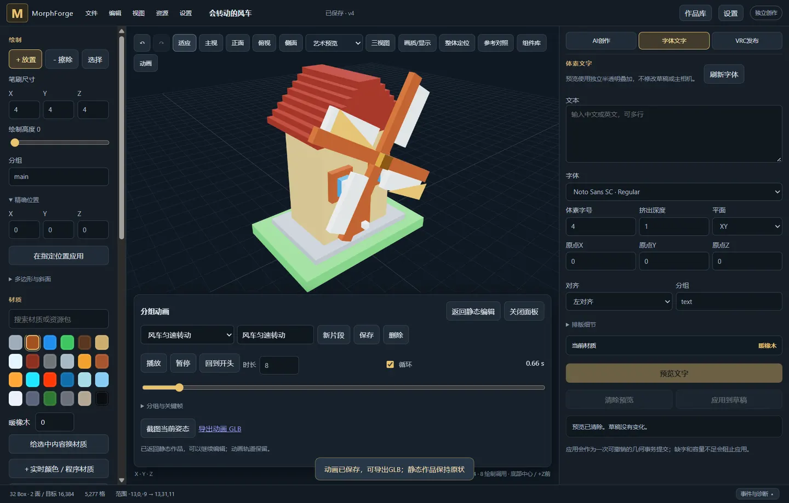
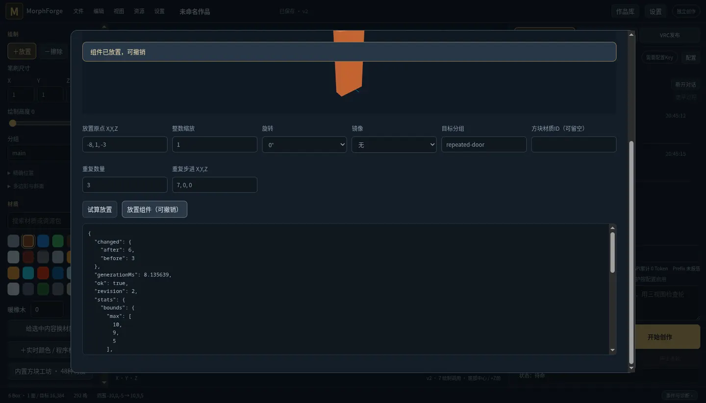
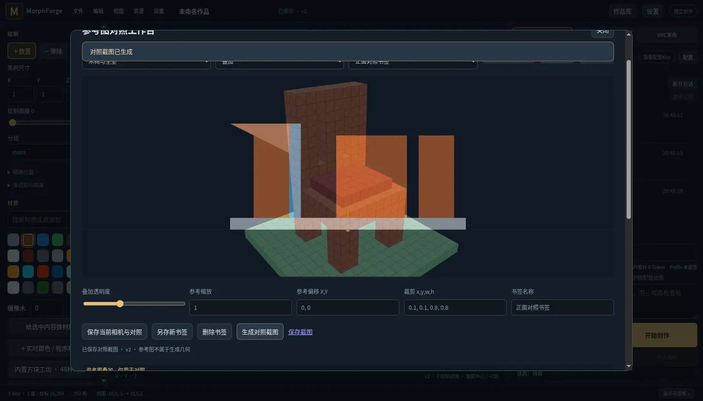

# 0.15.0 参考对照、组件与动画

2026-10-20，三项扩展已实现并安装到 gamepc「MorphForge - 开发测试副本」。关闭并重开副本进入 **0.15.0**；原验收版和运行中的旧窗口保留，没有发布 GitHub Release。

## 已交付

| 功能 | 行为 |
|---|---|
| 参考图对照工作台 | 从现有图库选择图片，并排或透明叠加；调整缩放、偏移、归一化裁剪。独立交互视口支持正交正/侧面、采用主视角，保存相机和对照书签，并生成带参考身份标注的真实截图 |
| 可复用组件库 | 从选区或分组保存，局部地面中心为默认原点；3D预览、更新/删除、整数倍缩放、四向旋转、镜像、目标分组、方块样式覆盖、沿步进重复。试算不改作品，放置可撤销/重试，尊重保护组 |
| 分组动画 | 平移/XYZ旋转/各轴正缩放、独立枢轴、线性/阶梯关键帧、播放/暂停/循环/拖动；插入中间帧从当前可见姿态开始。无效关键帧不损坏草稿。支持指定时刻截图和带动画GLB |
| Harness工具 | `components`、`reference_workbench`、`animation`；`capture_views`新增命名书签/对照和动画时刻。资产可在同一对话反复调用，跨该项目的其他对话/重启保留，`get_context`只带可发现摘要 |
| 示例与恢复 | 离线新增项目自制MIT「会转动的风车」，32 Box / 2面、窗户组件、正面书签和8秒循环。全部三类资产随项目JSON和作品保存，旧项目默认空资产，切换项目隔离 |

动画面板在视口下方停靠，为真实3D渲染预留独立空间；关闭的对照/组件窗口暂停自身渲染循环。拖动时间条后输入框显示当前插值姿态，精确关键帧保留原始360°等输入数值；保存前发生修改会隐藏旧动画导出入口，避免导出旧稿。

参考对照截图和参考原图始终标注用途，不把参考图片当作生成几何或美术质量验收。功能测试中的参考和测试几何可以不同题；风车是项目编写的参数化演示，不冒充模型生成作品。

## 验证

| 验证 | 结果与证据 |
|---|---|
| Rust工作区 | **225项通过**，包含6项新资产/变换/GLB专项；`rust-tests.txt` |
| Windows应用库 | **93项通过**；`windows-tests.txt` |
| Node | **56项通过**；新增旋转插值、枢轴、动画bounds、阶梯端点、中间插帧和完整转圈端点测试；`node-tests.txt` |
| 真实Chromium工作台 | **17项通过**：组件保存/试算/三次放置、参考保存/叠加/并排截图、多轨道/播放/姿态截图/GLB、项目往返；包含直接读取实例矩阵验证实际位置和旋转，不能只用“clip存在”证明显示正确；[browser-validation.json](browser-validation.json) |
| 补充按钮 | **15项通过**：侧面相机、删除书签、更新/删除组件并清预览、无效关键帧、枢轴中心、拖动后字段同步、中间插帧、删帧/回起点/删轨道/新建/删除片段；[controls-validation.json](controls-validation.json) |
| 完整Harness循环 | **10项通过、10次本地接口请求**：同一对话读取→绘制→保存组件→批量放置两个实例→读取组件→定义动画→保存相机→对照截图→动画截图→完成正文；实际工具分派和worker渲染，每次工具表不变、出站input严格只追加；[harness-validation.json](harness-validation.json) |
| Windows原生窗口 | 基础菜单/反馈/五种静态保存 **17项通过**；新增工作台与风车播放 **15项通过**。可信CDP指针操作真实Tauri/WebView2，且先校验隔离项目ID、0.15.0版本与实际内嵌UI哈希；[native-base-validation.json](native-base-validation.json)、[native-creative-validation.json](native-creative-validation.json) |
| 原生下载 | JSON、GLB、OBJ ZIP、PLY、STL和动画GLB **6个文件**均已在Windows独立下载目录验证；[native-download-validation.json](native-download-validation.json) |
| GLB标准校验 | 最终Windows下载的动画GLB经Khronos glTF Validator校验 **0错误、0警告、0信息**；[native-glb-validation.json](native-glb-validation.json)。不等于所有DCC/播放器的视觉兼容测试 |
| 一致性与静态检查 | **211个构建输入**在Linux与Windows构建前后匹配；运行中的原生窗口另核对所服务的creative-ui.js哈希。Rust fmt、Python/JS语法、库Clippy通过；Clippy沿用既有6类allow基线；[source-freeze.json](source-freeze.json)、[preview-install.json](preview-install.json) |

Harness使用localhost Responses SSE夹具，usage/cache字段是合成数据；它验证真实应用上下文拼接，不证明某个真实上游的缓存命中。**本轮真实付费模型请求为0**。全部测试使用隔离数据，OSC保持关闭；没有向9000或9012发包，没有修改Unity资源、上传头像或启动真实VRChat。

测试期间修正了对照canvas挤出布局、动画面板遮住作品、缩放后正交相机比例，以及关键帧字段/中间插帧/非法输入状态。一次原生验收因旧调试端口IPv4被占用而连到旧测试窗口，版本断言在任何编辑前拒绝；后改用独立端口并增加项目ID及内嵌源码哈希校验。测试窗口和临时调试转发在验收后清理，用户原窗口不关闭。

## 使用与边界

快速试用：作品库载入「会转动的风车」的可编辑副本 → 顶部「动画」→ 选择「风车匀速转动」→ 播放。组件库可重复放置「风车窗户」。新工具需要新对话或显式升级旧对话；沿用前缀重置告知与缓存保护，不静默重写历史。

组件实例展开为实际方块/三角面，不自动节省OSC字节。资产定义的保存/删除不并入几何撤销；放置操作可以撤销。组件依赖当前项目材质目录，尚无嵌套组件和跨项目材质重映射。

**动画目前用于编辑器、截图与GLB。当前MF6 Avatar发布静态草稿，没有分组关键帧播放器。** 播放不改静态几何、不触发逐帧OSC。GLB循环由播放器决定；图片纹理动画仍取首帧，不包含骨骼、物理或自动碰撞。后续原生运动需要验证持久运动槽、共享时间与后来者恢复、变换后Bounds/法线/透明面。[Avatar运动评估](AVATAR-MOTION.md)。

接口/上限/示例见 [API.md](API.md)。复跑工具：`tools/check_creative_workbench.py`、`check_creative_controls.py`、`check_creative_harness.py`（仅用于隔离后端），以及 `check_creative_native.mjs`（隔离Windows原生会话）。
