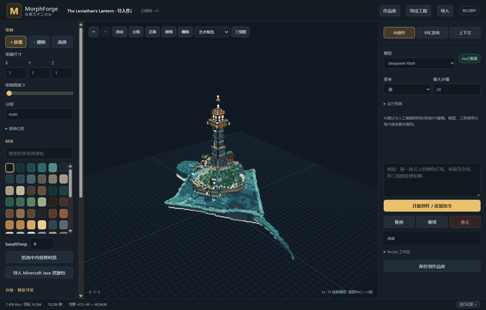

# Windows Tauri desktop validation

Date: 2026-10-19  
Host: Windows 10/11 x64, `GAMEPC\Chiro`  
Scope: Tauri 2 native shell, bundled Rust sidecar, NSIS installer, real interactive desktop session.

Unity and `Assets/` were not touched. The existing core on port `8766`, PID `126580`, stayed alive
through every test.

## Artifacts

| Artifact | Size | SHA-256 |
|---|---:|---|
| `desktop\target\x86_64-pc-windows-msvc\release\bundle\nsis\MorphForge Desktop_0.1.0_x64-setup.exe` | 7,564,188 | `CC535107346818E150E95F71519015B48FEC478BA4DB0B123073D29AFE50F3FF` |
| `desktop\target\x86_64-pc-windows-msvc\release\morphforge-desktop.exe` | 11,077,120 | `7FF2CDFA767E89ED3DC452F7E68A5D50FB820F0A5EEE534FB558F4D1D70BD8BC` |
| `desktop\target\x86_64-pc-windows-msvc\release\morphforge.exe` | 22,319,616 | `1951AE5DF028C1DAF356151754E06A70BC3F69929ABFF2891FA4888A032182CC` |

The NSIS payload was extracted to a temporary directory and verified to contain:

```text
morphforge-desktop.exe
morphforge.exe
```

The extracted payload hashes are:

```text
morphforge-desktop.exe  316169032EF029A8E2B32E8931896F8297B99C5C7347F64FD61A683BC7EC038C
morphforge.exe          1951AE5DF028C1DAF356151754E06A70BC3F69929ABFF2891FA4888A032182CC
```

The extracted sidecar hash is exactly the release sidecar hash. The desktop executable in the
installer is patched by Tauri with NSIS bundle metadata and therefore has a different hash from the
pre-bundle executable. The installer is not code-signed.

The stale `MorphForge_0.1.0_x64-setup.exe` in the same output directory is the earlier test build.
Do not distribute it.

The installer uses the product name `MorphForge Desktop` and current-user install mode. Its default
location is:

```text
%LOCALAPPDATA%\MorphForge Desktop
```

Core project data remains separate at `%LOCALAPPDATA%\MorphForge`.

## Build

Windows already had:

```text
rustc 1.94.0
cargo 1.94.0
stable-x86_64-pc-windows-msvc
tauri-cli 2.10.1 (npm)
Edge WebView2
```

The successful command was:

```powershell
powershell -ExecutionPolicy Bypass -File .\tools\build_windows.ps1
```

The script:

1. built release `morphforge.exe`;
2. checked its base filename and the `current_exe()` + `recipe-worker` source invariant;
3. copied it to the Tauri target-specific sidecar path;
4. generated the icon set with the installed `tauri` CLI;
5. built Tauri release and the NSIS installer.

The final package used the normal no-argument path. `-ReuseSidecar` was not used. The build began
from 44 frozen core, web and desktop source files with aggregate SHA-256:

```text
C05C6FFF4E96EDC4ABC2305B02C7A021B58E807DFA3C5967CDC08A86B9F0963D
```

The same 44 files and aggregate hash were present after the build; no concurrent source update
entered the release.

The exact file list and per-file hashes are in
[`source-freeze-final2.json`](source-freeze-final2.json).

## Windows tests

The final Windows suites passed:

- core: 35 tests passed, 0 failed, 1 writer-contention test filtered;
- desktop shell: 2 URL/security tests passed.

Windows intentionally skipped:

```text
periodic_refresh_waits_until_the_entire_previous_rebuild_was_sent
```

That test contends with the user's running writer lock. Linux has already exercised it; it should
be rerun after the long test ends.

The final release sidecar accepted a 16,384-operation recipe through its real
`current_exe()`-based `recipe-worker` path:

```text
dry run succeeded in 2.767 seconds
targetBoxes: 16384
voxelCount: 16384
```

This exercises the dedicated 16 MiB recipe engine stack and the Windows Job memory boundary. No OSC
sender was enabled.

## Interactive desktop test

SSH runs in Windows Session 0, so the desktop app was started through temporary scheduled tasks in
the user's active Session 1. All validation tasks were removed afterward.

The isolated test data root was:

```text
C:\Users\Chiro\tmp\morphforge\desktop-final-validation
```

The launcher set:

```text
MORPHFORGE_DATA=C:\Users\Chiro\tmp\morphforge\desktop-final-validation
```

The core log confirmed:

```text
MorphForge Rust ready: http://127.0.0.1:<random>
data=C:\Users\Chiro\tmp\morphforge\desktop-final-validation
OSC disabled
```

Observed hierarchy:

```text
morphforge-desktop.exe
  ├─ msedgewebview2.exe and renderer children
  └─ morphforge.exe serve --port 0
       └─ headless capture msedge.exe and renderer children
```

The real Tauri window was captured in Session 1:



Window metadata:

```text
title: MorphForge
viewport capture: 1800 x 1150
session: 1
responding: true
```

The page was the same HTTP workbench served by the core:

```http
GET /
200 OK
```

The transport state remained disabled; no OSC traffic was enabled.

The isolated library was a read-only copy of the user's three finished artworks and nine images.
The 7,459-Box `The Leviathan's Lantern · 精确体素版` was loaded through the same artwork fork API as
the library button. The final WebView then contained:

```text
boxCount: 7459
voxelCount: 70286
material meshes: 58
draw calls after fit: 61
WebGL context lost: false
```

The initial desktop screenshot was taken before the artwork camera fit, so it correctly showed the
unchanged startup camera rather than the distant 96-unit-tall artwork. Invoking the same
`renderer.view()` used by the UI load button produced the screenshot above.

The final renderer produced hero/front/top images from revision 1 in 0.467 seconds. Their hashes
are recorded in `validation.json` and the images are:

```text
docs/desktop/final-hero.png
docs/desktop/final-front.png
docs/desktop/final-top.png
```

## Provider authentication

The isolated core automatically loaded:

```text
C:\Users\Chiro\AppData\Local\MorphForge\provider.env
```

Its state reported:

```text
configured: true
baseUrl: https://api.deepseek.com
interface: responses
visionModel: deepseek-flash
fileUpload: true
```

One free model-list request was made:

```http
GET /api/provider/models
200 OK
```

The response contained exactly:

```text
deepseek-flash
deepseek-v4-pro
```

No creative/generation API was called. The key was never printed, logged, or copied.

The final release sidecar also ran `tools/check_backend.py` from Linux through an SSH loopback
forward to a random Windows port. All ten checks passed, including the strict malformed-scene
import guard:

```text
target_health
malformed_scene_import_atomicity
bad_material_import_atomicity
invalid_project_settings_atomicity
recipe_host_capability_isolation
infinite_recipe_failure_rolls_back_geometry
memory_limit_failure_rolls_back_geometry
duplicate_request_id_and_revision_conflict
catalog_zip_texture_references
diagnostics_redaction_and_exclusions
```

Report:

```text
docs/workbench/backend-validation-windows-final2-20261018T204358Z.json
```

The script called no provider generation endpoint and no OSC endpoint.

## Process cleanup

Normal close test:

- `WM_CLOSE` was delivered to the `MorphForge` window;
- the shell, core, WebView2 tree and screenshot Edge family exited;
- the random core port closed;
- port 8766 remained on PID 126580.

Crash cleanup test with capture Edge present:

```text
desktop PID: 131672
core PID: 129232
capture Edge root PID: 125292
capture Edge family before crash: 7
tracked process tree: 16
```

The desktop shell was then terminated with `Stop-Process -Force`. The outer
`JOB_OBJECT_LIMIT_KILL_ON_JOB_CLOSE` Job killed:

- the core;
- WebView2;
- the capture Edge family;
- conhost and other descendants.

After the forced shell termination:

```text
remaining tracked processes: 0
capture Edge family: 0
core alive: false
port 8766: PID 126580
```

This validates the orphan-Edge path in a real desktop session.

## Installer lifecycle

The final NSIS installer was installed silently into an isolated test directory:

```text
C:\Users\Chiro\tmp\morphforge\desktop-final2-install
```

Install exit code: `0`.

Installed payload:

```text
morphforge-desktop.exe  11,077,120 bytes
morphforge.exe          22,319,616 bytes
uninstall.exe              79,185 bytes
```

The installed sidecar retained hash:

```text
1951AE5DF028C1DAF356151754E06A70BC3F69929ABFF2891FA4888A032182CC
```

The installed app was launched in Session 1 with an isolated data root:

```text
C:\Users\Chiro\tmp\morphforge\desktop-final2-installed-data
```

It returned HTTP `200` on random port `50279` and exited normally after `WM_CLOSE`.

The installer's uninstaller was then run with `/S`:

```text
uninstall exit code: 0
installed executable files removed: true
HKCU uninstall entry removed: true
```

The uninstaller correctly removed its payload and registry entry. The validation report JSON had
been written into the test destination after install, so that report file was removed separately
before deleting the temporary directory.

Port `8766` remained on PID `126580` throughout installation and uninstallation.

## Concurrent-build impact

The final release compilation overlapped the active Unity long Play test. After the build and all
desktop tests completed:

```text
Unity UDP 9012: PID 46280
core TCP 8766: PID 126580
```

Neither process was stopped, restarted or changed for packaging. No Unity API or asset operation
was performed by the desktop validation harness.

## Test-data boundary

Every final GUI, artwork and API test used an isolated `MORPHFORGE_DATA` or a dedicated core
`--data` root. The default user library was copied read-only into the isolated root and was never
used as writable test state.

After all final runs, the default data still contained exactly three artwork JSON files and nine
images. Their aggregate hash was unchanged:

```text
48D21795F8B26A111A92387A23C06D81543FD2371B79F4E51D7493BA63C9F836
```

The default `project.json` also remained unchanged:

```text
length: 10008
sha256: 910FA1727E530EF5DB5888845D02154F880CF98E72DB2A0BE30ACE781AB541AC
```

The existing core on port `8766`, PID `126580`, remained alive. Unity's long test still owned UDP
port `9012` on PID `46280`; no Unity assets or Play Mode state were touched.

## Current limitations

- The installer is unsigned.
- The Windows model-list check validates authentication and free endpoint access, not a paid
  creative run. Full creative/tool-loop/compact continuation was already validated on Linux.
- Desktop acceptance does not replace the pending Unity FullFT joint-build and real VRChat tests.
