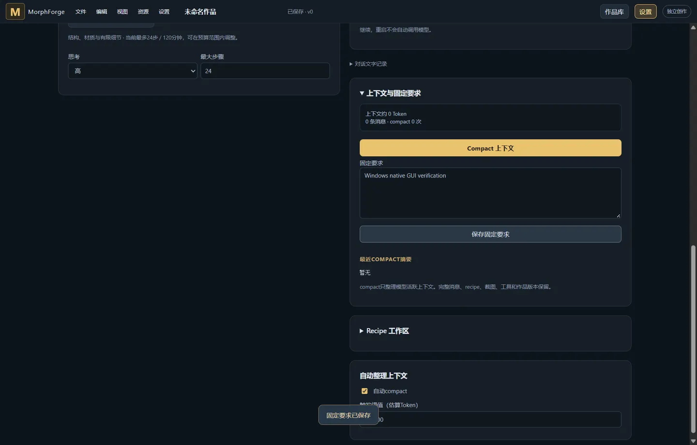
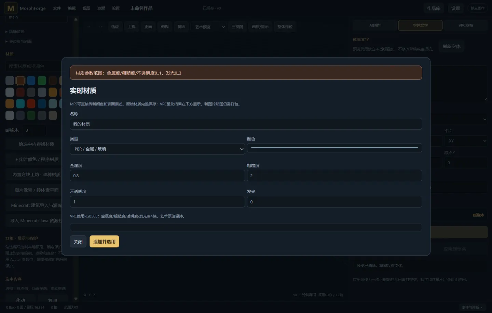

# 0.14.1 GUI 按钮验收

2026-10-20，已安装到 gamepc 的「MorphForge - 开发测试副本」。关闭并重新打开副本进入 **0.14.1**；更新仅切换不可变版本目录的启动指针，运行中的旧窗口和原验收版数据保留。本轮未发布 GitHub Release。

## 发现与修复

| 触发 | 原表现 | 修复后 |
|---|---|---|
| 设置页保存固定要求、执行 Recipe | 后端成功，提示留在已隐藏的工作台，像没反应 | 全局显示进度和结果 |
| 弹窗提交不合法材质参数 | 错误提示在原页面，被模态遮罩挡住 | 错误显示在活动弹窗顶部 |
| 切换右侧文字/发布/AI，再打开设置 | 上下文面板被标签切换隐藏 | 上下文设置持续可用 |
| 移动选区后再复制、旋转、镜像 | 方块规范化产生新 ID，原选区失效 | 按最终场景重新匹配选区，连续操作有效 |
| 对选区换材质后继续编辑 | 同样因 ID 改变丢失选区 | 保留换材质后的有效选区 |
| 从菜单触发当前不可用的操作 | 菜单仍像可点击，目标按钮实际不可用 | 菜单按目标状态置灰并给出原因 |

保存作品、执行/估算 Recipe、刷新字体补充等待与完成提示。选区修复覆盖方块拆分/合并、重叠复制、三角面复制与换色；16,384 个方块的选区也有专项测试。本轮未修改 OSC 协议、头像、模型提示词或工具 schema。

0.14.0 的复现见 [baseline.json](baseline.json)；Windows 原生修复截图：





## 验证方式与范围

浏览器通过 ChromeDriver 的真实指针点击操作实际 Rust 后端；导入使用生成的图片、六面材质 ZIP 和 Java NBT 建筑。Windows 使用实际 Tauri/WebView2 窗口，通过临时 CDP 端口发送可信鼠标输入，并核对下载目录中的文件；测试数据、WebView2 配置和下载目录独立于用户数据。

| 范围 | 结果与证据 |
|---|---|
| 普通 GUI | 设置、菜单、弹窗、5K/16K示例、绘制/擦除、撤销重做、选区变换/换色、三角面/斜面、字体、参考图库/像素/平面、Minecraft、作品库/截图、导入导出、分组/定位、Avatar目录、OSC端口、项目/对话。**124项断言通过**（含菜单别名补测及材质夹具修正），最终合并结果见 [suite-results.json](suite-results.json) |
| AI/观察 | **21项通过**：发送、暂停/继续、插话、排队、打断、停止、compact、缓存告警/确认、滚动后返回最新、时间轴筛选/只读版本预览、观察图片放大关闭。使用 localhost SSE 夹具，[ai-validation.json](ai-validation.json) |
| Windows 原生 GUI | **16项通过**，包含设置反馈、模态错误、绘制、菜单和五种保存；[native-validation.json](native-validation.json) |
| Windows 实际下载 | JSON、GLB、OBJ ZIP、PLY、STL **5个文件均有效**，按魔数/格式/文件长度检查；[native-download-validation.json](native-download-validation.json) |
| Rust 回归 | Linux工作区 **219项通过**，包含5项选区专项；Windows应用库 **87项通过**。见 `rust-tests.txt`、`selection-tests.txt`、`windows-tests.txt` |
| 前端与静态检查 | Node **51项通过**；Rust fmt、Python编译、JS语法及库Clippy通过。Clippy沿用已有代码基线的6项allow，具体命令见下方 |
| 构建/安装一致性 | Linux与Windows核对 **199个构建输入**，哈希一致；[source-freeze.json](source-freeze.json)、[preview-install.json](preview-install.json) |

普通完整复跑的 [browser-full-validation.json](browser-full-validation.json) 保留一处测试夹具失败：之前已创建相同属性的材质，后端按设计复用，旧断言却要求目录数量必须加一。已改为验证实际持久化属性及规范化复用，并通过 [browser-materials-validation.json](browser-materials-validation.json) 补测该流程，包含后续主题/资源包导入；合并结果不删除原失败证据。早期夹具还修正了等待弹窗关闭、筛选 debounce、居中零偏移、项目选择及滚动到可点击位置，均不作为产品故障计数。

按钮清单包括动态按钮、隐藏转发按钮和菜单别名，不能把清单总数宣称为全部独立功能通过。当前 schema 的工作区不会显示“升级旧对话工具”，本轮没有伪造旧 schema 点击它；“更早过程”已在存在早期分页时实际点击并验证；没有早期分页时应禁用。另见 [菜单别名补测](menu-validation.json)。这里验证的是本地 GUI 及其真实后端结果，不代表已完成所有上游服务、所有输入文件或真实 VRChat 多人验收。

本轮 **真实付费模型请求为0**。OSC仅发送到本机绑定的 `127.0.0.1:9012` UDP夹具；9000端口预设仅在发送关闭时切换，没有向真实VRChat发包。测试临时窗口已关闭；用户原窗口保留。

## 重跑

仅对专用隔离数据目录启动的后端运行；普通脚本会修改作品、设置和本地测试连接。

```bash
python3 tools/check_gui_buttons.py --url http://127.0.0.1:18015 --out /path/to/gui-results
python3 tools/check_gui_ai_buttons.py --url http://127.0.0.1:18015 --out /path/to/ai-results
node --test web/*.test.mjs
cargo fmt --all -- --check
cargo clippy --workspace --lib -- -D warnings \
  -A clippy::unnecessary_cast -A clippy::type_complexity \
  -A clippy::explicit_counter_loop -A clippy::needless_range_loop \
  -A clippy::needless_question_mark -A clippy::manual_is_multiple_of
```

Windows原生验收用 `tools/gui_native_launch.ps1` 在交互用户会话启动隔离测试窗口，随后运行 `tools/check_gui_native.mjs`。临时调试端口不写入正常启动配置。
