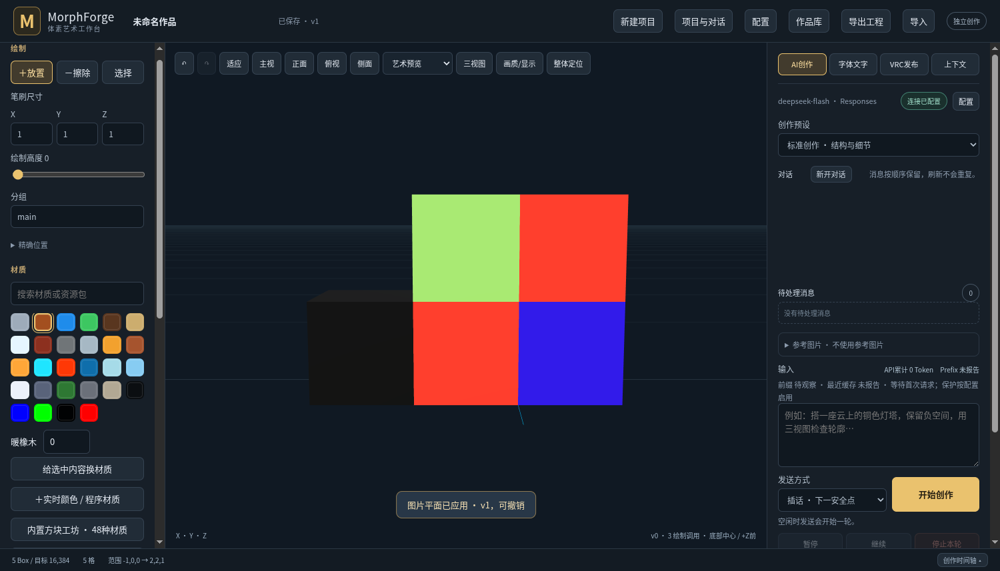
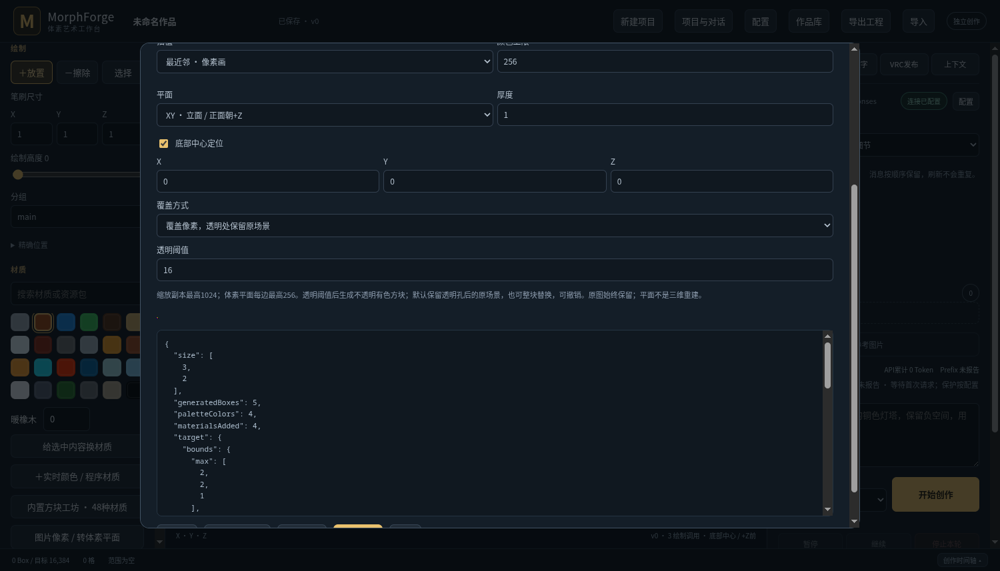

# 0.10 图片与持续同步交付

日期：2026-10-20。软件继续兼容MF5 Avatar v15、254bit；本轮没有改变Avatar线协议、重新上传头像、启动VRChat或向9000测试，没有付费模型调用。碰撞、三角面和更多通道是 [设计候选](DESIGN.md)，未作为已实现功能交付。

## 本轮实现

- `image_tools`：精确RGBA8点采样、网格采样、裁剪/缩放派生参考图；原图库图及署名保留。
- 图片转XY/XZ/YZ彩色Box平面：中位切分色板、透明阈值、默认透明孔叠加/可选整画布替换、已有材质代表色映射、预览、几何与材质共同撤销、分组保护及来源记录。MF5新RGB直接发送。
- `loopReplay`：上一轮完成后立即继续补播；周期等待刷新仍保留。新编辑优先，状态显示补播轮数，设置持久化，默认关闭。
- 三种MF5发送顺序：体积优先、Y/X/Z优先、材质优先；跨池删除屏障确保先发完旧几何删除，再绘制新布局。原池归属保存，重播不全局清空。
- 当前只加载一个Avatar的MF5场景；旧场景与模型资产保留。

## 验证

| 范围 | 结果 |
|---|---|
| Linux Rust | 最终全量174项通过 |
| Windows Rust / Desktop | 最终全量174项及2项桌面测试通过 |
| Node | 38项通过 |
| 图片API | 6项新集成测试：精确RGBA、裁剪/等比派生与许可、量化渐变、三平面、透明孔/矩形替换、撤销、保护与错误原子预检、现有贴图材质代表色、高ID边界 |
| OSC | 新增连续多轮UDP测试：startup后不全局Clear、至少三轮完整补播、停止循环、12块几何替换全路删除屏障；原120体素/20批配对、缩放和原有补播回归通过 |
| 排序 | 实际队列体积和底部优先顺序确定性检查通过；没有用严格全局排序牺牲三路并行 |
| 真实浏览器 | Linux/Windows交付包各13项通过；[Linux](browser.json)、[Windows](windows-browser.json) |
| Unity场景 | 实际总加载Avatar数1，MF5场景clean，NDMF内部预览场景Avatar数0；[证据](single-avatar-scene.json) |

新增UDP测试初次并发时争用了既有OSC独占锁，造成一个测试没有发包；已通过串行化相关fixture和等待发送器释放通道后再标记断开解决。生产环境继续保留单独占写者，逻辑通道在同一节流UDP发送器中复用。

## 安装与使用

gamepc开发测试副本已安装 **0.10.0**，运行目录为 `C:\Users\Chiro\AppData\Local\MorphForge Preview\versions\0.10.0-e015d0a3c25f`。原验收版核心SHA256未变；旧副本进程和数据保留，关闭重开“MorphForge - 开发测试副本”进入新版。见 [安装记录](installation.json)、[桌面核对](desktop-check.json)。没有发布GitHub Release。

左侧“图片像素 / 转体素平面”进入工具；先预览，再应用。VRC发布页的“完成后连续循环补播”需主动开启，同时保持OSC发送已开启；循环设置本身不会开启发送。旧对话需要显式升级工具说明到3.8或新开上下文，原消息前缀保留。

## 仍需明确

- 图片平面是图像颜色/材质的体素化，不是自动3D重建，不会把任意PNG变成Avatar内的新Unity贴图。
- 默认RGB像素只保留阈值遮罩，不保留源图连续Alpha；选择已有材质时沿用它自身的不透明度、纹理和表面参数。
- 几何补播与定位球世界姿态分开：当前14bit定位没有直接传XYZ/旋转快照，后来者原点一致性仍需单独验证；不能把几何到齐当作整个摆放状态已同步。
- 连续补播没有远端ACK。后加入者需要等待相关块被重播；漏删残留仍可能需要清空重建。低帧率/丢包下不能保证每轮完整送达。
- 删除屏障是发送顺序，不是跨玩家原子事务。全场景替换可能有暂时空缺；按区域事务和双缓冲尚未实现。
- 模板楔形/三角面、少量代理碰撞盒和4×60bit档仍要独立原生/客户端验证；当前头像保持MF5 v15。
