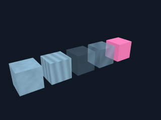

# MF5 0.9 验证与交付

日期：2026-10-20（Asia/Shanghai）。本轮没有调用付费模型，没有启动VRChat，也没有向9000发测试包；Unity使用9012，Rust协议测试使用临时本机UDP端口。

## 改动

新100%=旧5%，1%～1000%可调，实际scale仍保持物理值；实时RGB、量化PBR、程序水云木石、内置贴图染色；48种原创MIT方块纹理；三路双池配对发送；原池归属补播；微缩截图与纯色实例合批。详见 [设计](DESIGN.md)。

## 已完成检查

| 范围 | 结果 |
|---|---|
| Linux Rust | 最终全量166项通过 |
| Windows Rust | 本轮全量163项通过，最终相关61项通过；后者包含高ID、升级迁移、双池规划、实际UDP与补播、旧协议、Harness前缀和交互回归 |
| Windows桌面 / Node | 2项桌面测试、38项前端单元测试通过 |
| Unity原生OSC | 35项阶段检查通过：主/次池各8种表面、连续双体素、序号回绕、精确删除/重画、闲置保持、缩放及Avatar菜单；37个数据批次，0.25秒间隔；[证据](native-smoke.json) |
| GPU解码 | 504组真实GPU读取通过；[证据](gpu-probe.json) |
| 生产Shader | 两套Shader共40项实际像素检查通过，目录向后等价、实时表面可见、静态颜色/纹理随时间保持；[证据](visual.json) |
| 实际浏览器 | Linux与Windows交付包各21项通过；1%微缩透视/正交截图可见，5000种颜色为1个实例批次/1次draw call，换色正确，无JS/GPU错误；[Linux](browser.json)、[Windows](windows-browser.json) |
| 兼容浏览器 | MF4 8项、既有材质/截图/定位25项通过；[MF4](mf4-browser.json)、[既有功能](legacy-browser.json) |
| 参数 | 37项同步参数，254/256bit；三路几何240+定位14；面捕及本体额外同步0；[预算](budget.json) |

## 不可忽略的长时间损耗

首次原生16K测试以0.25秒发送2731批，实际保留16348/16384，六池各少6块，没有检测到重复或数据损坏。该结果保留在 [首遍报告](capacity-first-pass.json)。测试期间进行了Windows构建等并行工作，尚不能把损耗归因于某一种原因；它证明0.25秒并非无条件可靠。

第二轮完整通过：0.25秒发送2731批、耗时692.87秒，首遍16384/16384，缺块0、补发0、重复/数据错误0；六池数量为2731/2731/2731/2731/2730/2730。见 [完整容量报告](capacity.json)。测试端预留了本地缺块观测与0.5秒补发，但此次没有触发；产品Avatar和远端玩家没有这条ACK。两轮结果并存，不能据第二轮通过宣称所有帧率和真实网络都首遍零损耗。

软件提供盲补播：按同一粒子池重新发送完整目标，不做全局Clear；周期刷新也使用该路径。它可逐渐弥补漏画和给后加入玩家同步，局部重写仍可能短暂变化；漏掉删除命令造成的残留需要“清空并重建”。低帧率/卡顿下可提高间隔。多人效果仍待用户现场确认。

## 编辑器恢复

旧共享Store原型期间Unity曾原生崩溃，堆栈位于Analytics内存释放，原因未确定。旧共享Store已因重复/漏块的实测失败而弃用，不能把它与崩溃建立未经证明的因果关系。

原Temp场景备份和崩溃日志已归档到 gamepc `C:\Users\Chiro\tmp\morphforge\mf5-editor-recovery`。未保存场景从备份恢复为独立资源 `Assets/MorphForge/Diagnostics/Recovery20261020/UnsavedFullFT.unity`，恢复2项临时测试开关，未覆盖旧Diagnostic资产；见 [恢复记录](recovery.json)。测试隔离的其他场景对象在收尾恢复。

## 上传与桌面部署

- 私有头像 **MorphForge MF5 16K**，Avatar ID `avtr_df2ff222-b6ff-47fb-80be-e060868596a2`，Avatar version **15**、file version **11**，`pendingUpload=false`。
- generic / standard / security 三项服务端分析终态通过，VeryPoor；包约10.74MB，解压约91.96MB。见 [上传](upload.json)、[分析](analysis.json)、[预检](preflight.json)。没有以服务器通过替代真实客户端/多人验收。
- 开发副本 **0.9.0** 安装到 `%LOCALAPPDATA%\MorphForge Preview\versions\0.9.0-cd68930edf7e`；[安装记录](installation.json)。现有0.8进程保留，关闭重开“MorphForge - 开发测试副本”后进入新版。
- 当前作品ID/revision17保持，原实际scale=.05保持，OSC关闭。MF5目录以pending文件部署，新版重开时备份旧目录后切换MF5，避免改写运行中的旧版配置。见 [部署时实际状态](live-preview.json)。原验收版核心SHA256仍为 `23c86a41b05a8a61a67850dfbf180a9400d4cb4d9cfbfa7457c1b9198ee74d8a`。
- Editor已退出Play，其他场景对象恢复，FullFT与恢复场景均clean；MF5场景独立保存在工程内，见 [收尾](finish.json)、[隔离恢复](isolation.json)。
- 需要实测时重新切换配套MF5头像，重开开发副本；确认MF5/240bit、新100%，先用0.25秒观察本人/其他玩家，若有损耗提高间隔或使用补播。旧上下文需要显式升级工具说明或新开对话。
- 本轮未创建GitHub Release。

## 实际限制

- RGB24模式保留精确8bit颜色；PBR为565颜色与4档表面参数，程序材质为444颜色、4档表面参数、8档比例/种子。艺术原值不被量化覆盖。
- 任意新PNG贴图仍须打包；48种像素纹理是原创Minecraft风格，不含Mojang素材。
- 实时透明材质没有内部面遮罩，透明排序仍为粒子近似；水云是表面效果，不是物理水体/体积云。
- 切换到MF5需要新版配套头像及目录；MF4的Ctl、缩放和材质编码不能混发。
- 工具schema3.7需要旧上下文显式升级或新开对话；没有为新增工具悄悄改写已有消息前缀。
