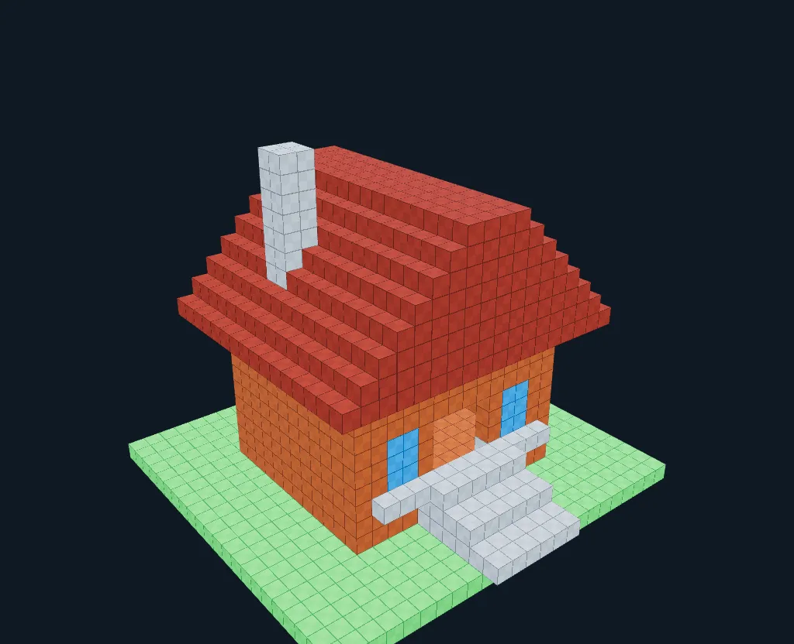
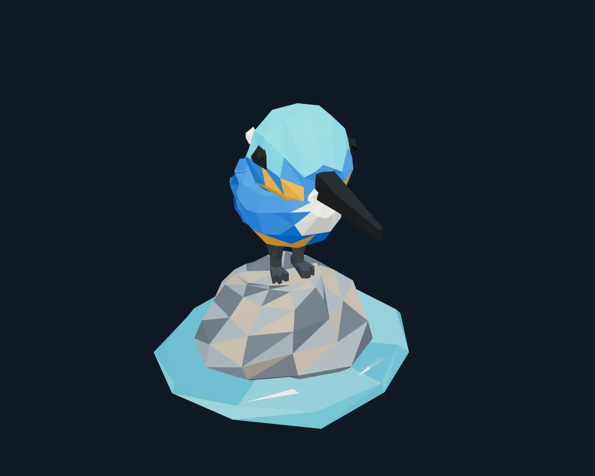

# MF6 真实模型创作验证

2026-10-20，软件0.13.0，`morphforge-system/5.0`、`morphforge-tools/4.0`。使用官方DeepSeek-V4.1-Flash（API名`deepseek-flash`），Responses、图片inline、high推理、中文精细preset。没有用手写几何替代模型产物；测试数据与用户工程隔离，全程禁用OSC，没有上传头像或发布Release。

本轮验证看图建模、真正三角面、持久源码、自选截图、截图后的几何修改及自动收尾。不是与dsh的同条件对照，不能据此宣称质量追平。

## 看图复刻：红顶小屋

| 项目原创参考图 | 模型最终几何的实际截图 |
|---|---|
|  |  |

模型仅接收`builtin:cottage`图片，不载入现有作品或参考图的绘图源码。最终162 Box、8种实际使用的自定义RGB样式、0三角面，坐标满足MF6。主体识别点可见，薄草地、红色分层屋顶、暖墙、蓝窗、门洞、浅灰台阶均有体现；烟囱位置、屋顶与窗门比例是近似，并非准确复原。

模型真实执行了两版几何（176→162 Box），首次截图后改写源码、重新运行、重新截图。首次运行7个响应、259,997 Token，实际输入234,668，缓存224,256，命中95.56%；输出25,329（含上游计入输出的推理）。最终准备再修改源码时被累计预算保护停止，最后一份源码patch没有运行，不能把它算作已实现。

尝试一次只收尾的续作，2个响应、108,825 Token，输入108,197，缓存102,400，命中94.64%；模型get_context、重截图后，再次被严格模式的估计输入预留拦住，未调用finish_artwork。停止这件作品的进一步付费调用。验收者检查截图后手动调用finish_artwork归档，未修改几何，`sourceRun=null`；**两次run均保留失败状态，未伪报自动完成**。

连同2次缓存探测，总396,365 Token；[完整实际usage](reference/final-usage.json)。初次7响应的Token不是一次请求上下文长度，累计输入包含缓存重复读取。总Token不能直接当作未缓存计费Token或换算费用，本轮没有取得账单金额。

证据：[首次报告](reference/initial-report.json)、[收尾报告](reference/finish-report.json)、[手动归档](reference/manual-archive.json)、[可导入作品](reference/finish-artwork.json)。原始工具/上游事件保存在`reference/*-events.jsonl.gz`，可用`gzip -dc`读取。`executed-main.js`为实际运行到revision 3的模型源码；`unexecuted-main.js`是预算停止时未执行的修改，二者明确区分。作品JSON为最终几何的权威记录。

## 纯三角面：溪石上的翠鸟

最终1,135个真实三角面、0 Box、593个按组和位置合并后的不同顶点，逐面纯色，无UV；三组分别为鸟、河石、水面。MF6整数坐标与3,500面测试容量检查通过。共享顶点由模型的索引网格源码生成，落入工作台后为带稳定ID的Triangle3，不是把Box渲染成三角形的截图。

模型做了三版：996→961→1,135面，使用自选局部/侧面视角，并在首轮、第二轮真实截图后分别修改。它自己指出长腿、头身球状感、平板状羽片等问题并调整；[首稿](polygon/iteration-1.png)、[第二版](polygon/iteration-2.png)、[最终正面](polygon/front.png)、[最终俯视](polygon/top.png)保留。最终长喙与鸟类配色可读，足石接触较首稿改善，但头身仍偏卡通、羽翼层次较粗，不能称为已达到精细雕塑水平。

7个响应，538,062 Token（输入469,255，缓存417,024，**88.87%**；输出68,807）。第一响应约160秒，大量推理后直接写源码，没有按系统要求先get_context；后续索引网格运行成功。最后一个响应运行第三版并截图后，因为累计余量无法满足严格模式的保守输入预留，下一请求被阻止。模型未再看到这次最终截图，也未finish_artwork，**全自动完成检查失败**，不再进行付费续作。验收者检查最终真实三视图后手动归档，未改几何。

[离线拓扑诊断](polygon/topology.json)：退化面0、双面共享边的绕序冲突0、开放边3、非流形边16。诊断按同组等位置焊接，接触/重叠壳体会影响计数；至少开放边说明不能宣称完全闭合。该项目的“闭合拓扑”要求未全部通过，后续应给模型提供执行后的拓扑反馈与局部修复工具，而不能仅依靠截图或工具成功回执。

[原始报告](polygon/report.json)保留success=false及失败原因；[可导入作品](polygon/artwork.json)、[模型源码](polygon/main.js)、[手动归档记录](polygon/manual-archive.json)、[实际用量与前缀状态](polygon/final-usage.json)、压缩完整事件`polygon/events.jsonl.gz`。含缓存探测565,635 Token。报告中的最终评测截图是评测器补抓，`review-capture.json`是验收者高分辨率补抓，不冒称为模型看过的截图。

## 缓存与费用保护

两个案例都先用2次小请求确认上游`usage`中的实际cached tokens，再开启付费建模；不是用本地前缀相同比例冒充缓存命中。严格监测持续开启，模型配置和系统/工具静态前缀在各对话内保持稳定，记录appendOnly与staticPrefixUnchanged。新图片、工具结果、推理等追加内容本身尚未缓存，单次命中率下降不等于历史前缀被重写。

小屋原预算300K，续作180K；这是真实累计预算实验，不修改软件默认1M上下文/384K输出容量。三角面案例根据小屋的累计输入成本将测试预算定为650K（包含探测的数据目录限额680K），每次响应最高65,536、最多16步、20分钟；不使用无限Goal续作。

本轮含两组缓存探测、小屋唯一一次收尾续作，共962,000累计Token：输入867,182，其中缓存781,056（加权90.07%）、未缓存86,126；输出94,818。无缓存告警，两个最终出站前缀均为appendOnly=true、staticPrefixUnchanged=true；[汇总](usage-summary.json)。这些均来自上游实际usage，未获得人民币账单金额，没有把缓存Token按免费处理。

## 暴露的问题与下一步

- 两件作品修改源码时都出现`expectedHash`误用，系统安全拒绝后模型自纠；应优先减少哈希字段混淆和长源码重复发送，用更直接的patch示例或编辑模板做下一轮对照。
- 小屋没有自动收尾，严格预算保护保住草稿和费用边界，但其输入估算比实际上游输入保守；收尾应更早预留get_context、截图与finish三个响应，避免只按输出/几何复杂度估算成本。不要简单删除预算保护或关闭缓存监控。
- 三角面Recipe返回的`changed.before/after`沿用Box计数，会显示0→0；评测脚本已经按scene中的真实triangles计数，不能将该回执解读为没有几何。后续工具回执应分别提供box/triangle/object变更。
- 自动结构检查不能代替艺术质量验收。三角面诊断按同组同位置焊接顶点统计开放边、非流形边和绕序；重叠壳体可能影响计数，它不证明无自交。

## 重现与离线检查

`cases/*.json`保留真实提示词与预算；小屋的初次失败和收尾续作分别保存，不改写成成功案例。使用`tools/evaluate_harness.py`配合独立loopback后端运行；后端自行读取本机凭证，runner不读取Key。真实重跑会收费，先小请求预热并确认实际命中，再传`--require-cache-hit`及`--lifetime-token-limit`。

本轮评测器补充纯三角面非空判断、对象容量/坐标、导出与拓扑诊断，缓存告警时停止后续调用并保留证据。已检查闭合四面体、开放面、反向面的诊断结果、Python编译及模型实际执行源码的Node语法。截图为真实WebGL渲染、2×超采样；README使用压缩WebP，没有人工重绘。
