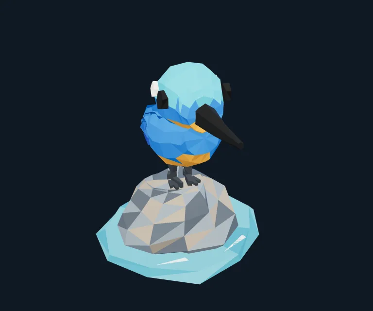

# 放宽预算后的真实模型续作

2026-10-20，按用户要求放宽评测预算，沿用首轮两个独立数据目录和完整上下文继续创作，未从零重生成。软件仍为0.13.0，模型/推理/语言/系统与工具schema不变，保持append-only和严格缓存监测。原始预算失败记录保留在[首轮报告](../RESULTS.md)。

## 预算设置

| 字段 | 原评测限制 | 本轮续作限制 |
|---|---|---|
| 累计Token／每件 | 小屋300K，收尾180K；翠鸟650K | 8,000,000 |
| 最大响应步骤 | 16；小屋收尾3 | 48 |
| 活动时间 | 20分钟 | 2小时 |
| 单次最大输出 | 65,536；小屋收尾8,192 | 393,216 |
| 上下文 | 1,048,576 | 1,048,576 |

软件的精细preset原本已经允许32M累计Token／128步／6小时，本次提高的是评测限制，没有降低或额外提高产品默认值。预算为上限，不要求模型耗满；实际usage中的输入包含反复读取的缓存历史。保留输入预留、总用量上限和缓存告警暂停，未通过关闭保护来取得成功。

两份续作提示词见[cases/expanded-budget](../cases/expanded-budget/README.md)。原始case及其失败报告没有改写。小屋续作要求检查前次未执行的源码修改，再修正比例；翠鸟额外获得首轮真实拓扑统计，要求源码诊断/修复。续作增加的用户指令只是追加历史，不改变静态前缀。

## 小屋：自动完成

最终184 Box、9种使用样式、0三角面，revision 8。模型检查前次修订，进一步修改烟囱位置和高度、屋顶阶梯、门窗与台阶比例以及门框颜色，主动裁切读取截图检查细节，复核当前三视图后调用finish_artwork提交和入库。评测报告success=true，全部15项检查通过，包括截图后实际几何修改、当前视图入库、MF6范围以及保持OSC关闭。没有验收者手动补保存。

新增12个模型响应，1,046,383累计Token：输入1,026,402，其中缓存994,944，实际输入命中率96.94%；输出19,981。耗时约162秒（含评测器补抓截图）。预算没有耗满，也没有因累计余量触发停止。上轮上下文保留，所以这不是独立从零的第二次复现。

图形仍是近似复刻：墙面和草地为纯色，不包含参考图逐格纹理；烟囱帽和屋顶节奏有简化，背面采用对称补全。模型最终summary包含自己的差异说明，原文保留在报告；艺术质量不由自动检查宣称“完全一致”。

[评测报告](reference/report.json) · [可导入作品](reference/artwork.json) · [模型源码](reference/main.js) · [累计usage与前缀](reference/final-usage.json)。完整事件为`reference/events.jsonl.gz`。报告的PNG是评测器最终补抓，模型自己看过和保存的artifact可从tool.result／artwork.saved核对。

## 翠鸟：续作记录

最终1,134个真实三角面、0 Box、618个按组/位置合并的不同顶点，revision 7；鸟932面、石154面、水48面。模型从先前源码续作，增加可执行的坐标焊接边审计，第一次因非流形边被自己写的strict审计拒绝，随后修复薄端环整数舍入塌陷、趾部共点共边等问题，再按侧面、正交、局部截图继续改形。

最终评测器独立诊断：**开放边0、非流形边0、退化面0、共享边绕序冲突0**，与模型源码审计一致。鸟体由多个闭合且互相穿插的壳体组成，未做布尔并集；这些边统计不等于无自交证明，也不代表任意连接处都是连续单一实体。

新增16个模型响应，2,857,320累计Token：输入2,780,453，其中缓存2,734,976，实际输入命中率98.36%；输出76,867。耗时约365秒（含评测器补抓）。模型看过最终三视图后自动调用finish_artwork入库，报告success=true，全部15项检查通过。人工没有修改几何或补保存。

这轮保留4次真实工具错误：源码strict审计发现非流形边、patch匹配0处、截图视角数超过5、finish引用了不存在的artifact；模型都在同一上下文中自纠，不靠清空历史解决。充足预算给了它恢复机会，同时也显示工具参数的容错与编辑模板仍有优化空间。

美术上缩短腿、收窄喙、改善脚石接触，修正羽片和头身轮廓；整体仍偏卡通，橙胸和白喉在不同角度有遮挡，趾为简化棱柱，缺少细横斑和逐根尾羽。不能将拓扑检查通过当作美术质量已经追平外部dsh。

[评测与拓扑报告](polygon/report.json) · [可导入作品](polygon/artwork.json) · [带strict审计的模型源码](polygon/main.js) · [实际usage与前缀](polygon/final-usage.json) · [正面](polygon/front.png) · [俯视](polygon/top.png)。完整事件为`polygon/events.jsonl.gz`。

## 实际用量与结论

| 续作 | 响应数 | 新增累计Token | 实际输入缓存命中 | 自动保存 | 边拓扑诊断 |
|---|---:|---:|---:|---|---|
| 小屋 | 12 | 1,046,383 | 96.94% | 通过 | 体素，不适用 |
| 翠鸟 | 16 | 2,857,320 | 98.36% | 通过 | 四项均0 |

本次续作合计3,903,703 Token，输入3,806,855、缓存3,729,920（加权97.98%）、未缓存输入76,935、输出96,848；[实际汇总](usage-summary.json)。不包含首轮962,000 Token，没有取得实际货币账单，不能将累计Token按冷输入估价，也不能把缓存视为免费。

两条会话全程无缓存告警，最后出站前缀appendOnly=true、staticPrefixUnchanged=true。扩大累计预算后，模型均在8M上限内主动完成；首轮失败说明当时评测预算偏小，不能据此判定模型没有收尾能力。此轮同时增加了明确的续作/拓扑反馈，因此不是只改变一个预算变量的严格A/B实验。

## 验证边界

本轮没有改应用代码、安装桌面版本、发送OSC或上传头像，也未发布Release。截图为实际工作台WebGL渲染，README使用压缩WebP；保存源码和可导入几何是模型真实输出，不由验收者手工修造。自动创作保存、几何拓扑、美术质量与上游缓存分别评估。
