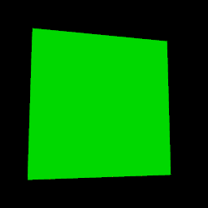
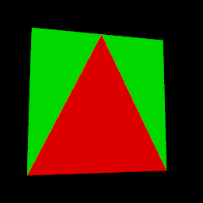

# 发送档位与共面闪烁：0.15.2

2026-10-21。gamepc开发测试副本已更新为0.15.2；主安装0.15.0与正在运行的进程保持原状。未发布GitHub Release，未上传头像，没有向真实VRChat或Unity接收器发送任何新OSC命令。

## 发送档位

VRChat发布页开放0.10、0.20、0.25、0.28、0.30、0.40、0.50秒。原默认值0.25秒保留，不自动更改用户正在使用的设置；0.10/0.20标为快速试验，不能把它们视为本机接收器或多人网络已经验收的速度。后端原本支持更广范围，API设置的自定义数值仍可正确显示并保留。

间隔控制每批发送的节拍。本机执行ACK无法确认其他玩家接收，0.25秒也没有远端可靠性保证；更慢档位仍需结合补播。当前产品没有接入本地执行ACK，回读研究见`../region-ack-research/RESULTS.md`。

Windows实测发现，状态轮询可能在配置提交后返回旧值，快速修改间隔时会覆盖刚选中的数值。已将连接设置写入排队，并用代次排除过期快照；提交期间保留尚未写完的表单值，最后一个成功提交的设置作为权威状态。工程切换时取消旧工程尚未执行的配置。新增快速连续修改后再轮询的回归。

`tools/check_interval_transport.py`连接独立空白后端，绑定随机的本机UDP端口，仅接收该夹具的真实OSC bundle。对每档采样，切档后丢弃前两包，核对后续间隔和目标版本不变。22项检查全部通过；`udp-intervals.json`记录实际中位数约0.106/0.208/0.256/0.285/0.306/0.407/0.506秒。它验证外部发送器，不验证头像执行或多人收到。

## 明确发现的闪烁来源

对用户当前作品做只读快照分析：258 Box、298三角面；Box体积重叠为0，完全重复三角面为0，但存在135对三角面与Box表面共面、投影覆盖面积大于0的组合。135是重叠配对数，不是135个独立对象。原始作品快照只保留在私有临时目录，仓库仅记录汇总`scene-audit.json`。

这类相同深度的表面会竞争深度缓冲，改变观察角度或绘制顺序即可使不同表面胜出；放慢OSC不会消除已经存在的共面冲突。此次发现与修正不排除其他原因，如远端遗留旧几何、透明排序、三角面互相共面或补播重生时的瞬态闪动。

渲染策略确定为：共面时三角面细节优先于体素表面，模型顶点与OSC坐标不动。编辑器两种预览模式使用三角材质polygonOffset；Avatar生产Shader增加专门的三角面Pass，只有该Pass采用可调的深度偏移。体素和透明介质仍使用原有路径。硬件深度偏移的官方说明：https://docs.unity3d.com/2022.3/Documentation/Manual/SL-Offset.html 。

修改额外增加一个Shader Pass，存在相应绘制开销；没有增加同步参数或动画器层，也没有改变MF6的线格式。

## GPU证据

`AgentScripts/CoplanarDepthProbe.cs`通过unity-pipeline运行。在MorphForge工程中创建临时附加空场景，构造具有粒子顶点流布局的合成Mesh输入，以隔离测试生产Shader的深度行为；不会进入Avatar Play Mode。测试完成恢复原活动场景、关闭临时场景，核对原场景dirty状态不变，临时旧版Shader通过Pipeline删除。

| 测试 | 旧版负对照 | 修正后 |
|---|---:|---:|
| Unity生产Shader，7个方向、2个距离、2种绘制顺序及较近遮挡物 | 29项中22项失败 | 29项全部通过 |
| Windows WebGL，两种预览模式、7个方向、2种绘制顺序 | 28项中26项存在共面冲突 | 28项全部通过 |

Unity结果在`unity-depth.json`。WebGL使用三角面单独显示、Box单独显示及空背景的实际参考像素确定共同内部区域，再比较重叠后的像素是否与三角面参考相同，避免把环境光照造成的颜色变化误判成深度失败。`native-validation.json`保存56项正负像素用例以及17项控件/状态检查。其错误监听只覆盖未处理JS异常；GPU正确性由实际像素断言提供。

旧版示例：

修正后，相同位置的三角面稳定显示：

这些是Shader/GPU隔离测试，不是原生粒子出生、VRChat实际运行或多人显示验收。几何分析和像素测试也不能当作网络丢包修复证据。

## 交付范围

- 桌面程序：0.15.2开发测试副本已部署，包含七档、配置竞态修正及预览深度优先级。旧Preview数据保留，未复制活动主数据。安装和主程序完整性证据见`preview-deployment.json`、`final-install.json`。
- Avatar源文件：`Assets/MorphForge/Shaders/ParticleBoxCatalogMetadataGrid.shader`已修改，并导入gamepc的MorphForge Unity工程验证。**当前VRChat已上传头像仍是旧Shader，必须重新构建上传后才会生效；本轮未上传。**
- Node 56项通过，JS/Python语法及Rust格式检查通过；Rust功能代码未修改，仅版本号变化并完成Linux/Windows构建，没有重复宣称新的全量Rust测试。
- 真实模型请求0次。网络测试只使用Linux隔离后端的随机UDP回环端口；Windows原生GUI全程关闭OSC，未获取用户正在使用的发送租约。

测试过程中修正了验收脚本的启动等待、渲染尺寸恢复和艺术模式参考像素判定问题；最终正负对照均按实际像素验证，未用读取CPU材质属性替代GPU结果。临时GUI窗口、计划任务、Linux测试后端与OSC夹具已清理。
