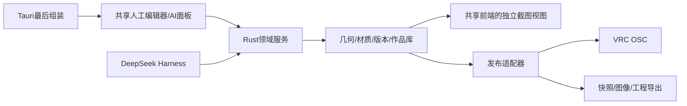

# 独立工作台架构

## 模块与权威状态

Rust核心不得依赖Tauri/Unity。独立进程提供HTTP API、CLI、后台调度；前端与Tauri适配同一领域接口。场景状态在后端持久化，窗口关闭不丢作品。模型/人工修改有baseRevision，冲突时拒绝事务并让调用方读新版本，不覆盖人工新修改。

作品状态分为draftRevision、committed revision、published target、sent ledger；没有远端ACK时不显示“远端已应用”。目标支持能力单独描述：逻辑范围、样式映射、粒子总/分池容量、协议、通道数、节拍。无VRC目标时这些不限制普通创作。

## 数据契约

通用场景保存有符号整数格坐标、单位格长、稀疏互不重叠长方体、稳定材质标识/兼容styleId、染色/动画预设、逻辑分组、相机与目录版本。空间和资源保护阈值可配置。普通几何操作：box/erase/paint/clear、批量事务、移动/复制/镜像/90度旋转、命名分组与选择。任意角度体素化是后续明确操作，不暗中增加碎片。

盒体相减至多6片，完整相邻同外观面可合并；使用空间索引避免每次两两O(n²)校验。事务失败保留旧状态。版本快照不可变，运行日志追加；工程写入采用原子替换。请求ID保证重试不重复应用。

## 一个前端

- 顶部：工程、保存、版本、AI状态、OSC状态。
- 左侧：绘制/擦除/染色、尺寸/精确坐标、选择、分组、材质、作品库。
- 中央：实例化3D画布、前后左右标记、底部中心、视角预设、选区与差异。
- 右侧：AI对话、属性、连接/发布设置；AI与发送各有独立控制。
- 底部：可折叠时间线、工具详情、错误、compact记录。

渲染按材质实例化，以解析AABB拾取映射稳定Box标识；增量更新脏实例，不为16k盒建立16k Mesh与独立纹理。截图共用同一渲染代码，但独立相机/画布，绑定revision和请求ID，不影响人工视角。清除UI/grid/ghost，固定背景/色彩与相机；失败不返回旧帧。

镜像修正必须用非对称方向标识验证，统一核心坐标和VRC基变换，不靠临时相机翻转掩盖。编辑器显示逻辑格尺寸和Avatar显示缩放两套量。

## 发布与运行

OSC单一写入者、跨进程排他锁、可配置目标端口、限速、恢复、任务合并。AI可以继续编辑draft，已发布目标在后台发送。已在途命令完成后重新比对最新目标。显示pending命令数、ETA、错误、发送版本。支持手动重建与周期刷新；刷新帧共享同一writer，不插坏几何事务。

当前CLI提供 `serve / check / recipe / benchmark`，作品管理和运行记录通过共享前端与HTTP领域接口操作。专门的CLI作品管理/回放子命令可后续扩展。Windows原生构建/测试已单独验收；Linux通过不能代替Windows交付。Tauri只组装窗口、进程生命周期和打包，核心仍独立运行。
