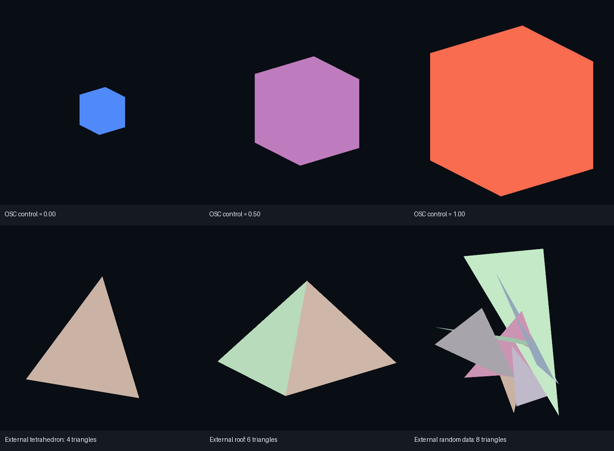

# OSC 输入与外部坐标造型：第 1 / 4 项原型

日期：2026-10-18。当前验证采用直接参数与 Gesture Manager 原生 OSC，不使用 KipSeek 的分页、编码或队列格式。

**Editor 验证通过：39 项检查全部通过。** 外部 Python 通过 UDP 发送参数，Gesture Manager 接收后驱动实际 FX 控制器和材质；新坐标在固定载体上显示为四面体、屋顶和随机三角形。

## 验证边界

环境为 Unity 2022.3.22f1、Gesture Manager 3.9.9、MA/NDMF、Windows PC。没有运行真实 VRChat 客户端或上传 Avatar；本轮没有验证多人同步、远端量化、VR 双眼、动画轨迹或 AI。

这验证了 Editor 中的数据到显示链路和 Shader 造型基础，不代表真实客户端第 1/4 项已全部通过。

## 项目入口

| 项目 | 路径 |
| --- | --- |
| 场景 | `Assets/MorphForge/Scenes/MorphForge_Probe14.unity` |
| 独立 MA 模块 | `Assets/MorphForge/Probe14/MorphForgeProbe14.prefab` |
| Nemesis 测试 Avatar | `Assets/MorphForge/Probe14/ProbeAvatar.prefab` |
| 固定载体 | `Assets/MorphForge/Probe14/Carrier.asset` |
| Shader 源 | `Assets/MorphForge/Shaders/ProbeGeometry.shader` |
| 生成入口 | `AgentScripts/Probe14Entry.cs` |
| 自动验证 | `tools/check_probe14.py` |
| 外部发送端 | `tools/send_probe.py`，Python 标准库，无需安装依赖 |

场景、Prefab、Mesh、材质、动画剪辑和控制器均由 Pipeline 调用 Unity API 创建，保存在 Windows 工程。Linux 目录保留源代码与验证产物。

基础 Nemesis 场景保留；本轮建立了独立 Probe14 场景。检查结束后已退出 Play Mode并关闭测试接收端。

## 直接参数约定

所有地址前缀是 `/avatar/parameters/`。

| 参数 | 类型和范围 | 用途 |
| --- | --- | --- |
| `MFProbe_Control` | Float，0–1 | 信号方块颜色与绘制尺寸 |
| `MFProbe_Visible` | Bool | 控制两个探针的显示 |
| `MFProbe_Count` | Float，0–1 | 乘以 8 后得到有效三角形数量 |
| `MFProbe_V00`…`MFProbe_V71` | Float，-1–1 | 24 个顶点的 XYZ 展平坐标 |

共 75 个参数，全部设置为 local-only，新增网络同步预算为 0；不将这些直接通道当作多人传输方案。

每个三角形有 3 个独立顶点，最多 8 个三角形。坐标在几何对象的局部空间解释，之后受模块 Transform 影响。未使用三角形退化为零面积。

OSC 发送器采用标准 bundle 并重复发送。本轮只验证本机 UDP 和 GM 接收，不以此承诺可靠、原子或远端同步传输。

## 观测结果

| 检查 | 结果 |
| --- | --- |
| 外部控制值 | 0 / 0.25 / 0.5 / 0.75 / 1，实际参数均对应 |
| 材质控制值 | 对应同样 5 档，实际颜色由蓝到红 |
| 信号投影面积 | 11,225 → 142,601 像素，尺寸明显变化 |
| 四面体 | 4 三角形，72 个参数与外部输入一致 |
| 屋顶 | 6 三角形，72 个参数与外部输入一致 |
| 随机输入 | Python seed=13579，8 三角形，参数与外部输入一致 |
| GPU 与 CPU 参考图 | 三组均逐像素一致：RGB 平均/最大差为 0/0 |
| Avatar 载体 | CPU 顶点始终为零，24 个顶点和索引保持不变 |
| 载体资产哈希 | 前后 SHA-256 相同 |
| 外部隐藏 | 显示像素为 0 |
| MA/NDMF 处理后 | 75 个参数仍有声明，均不同步；Missing Script=0 |

四面体、屋顶与随机顶点来自外部 Python 数据，没有作为模型写入 Avatar。Shader 根据参数改写绘制位置；Avatar 上的 CPU Mesh 不变。

CPU 参考 Mesh 仅由 Editor 检查程序临时创建，用于独立比较。同一组外部坐标一边通过 OSC/Animator/Shader 显示，一边形成测试参考；参考对象不保存在 Avatar 中。



原始结果：[39 项检查](validation.json)、[MA/NDMF 处理验证](export.json)、[屋顶输入](geometry-roof-input.json)、[屋顶实际图](geometry-roof.png)、[屋顶参考图](geometry-roof-reference.png)。

## 自动复现

在 Editor 打开 `MorphForge_Probe14.unity` 并保持 Edit Mode，然后在 Linux 的 `morphforge` 目录执行：

```bash
python3 tools/check_probe14.py
```

程序会进入 Play Mode，启动 Gesture Manager 自带 OSC，使用 Windows 上的独立 Python 进程发送 UDP，检查参数和渲染结果，最后退出 Play Mode。它不会接管已经运行的 Play Mode。

## 手工体验

1. 打开测试场景，进入 Play Mode。
2. 点击 `Tools → MorphForge → 2. Start Gesture Manager OSC on 9010`。
3. 在 Windows PowerShell 中切换到 Unity 工程目录并发送：

```powershell
python tools/send_probe.py signal --value 0
python tools/send_probe.py signal --value 1
python tools/send_probe.py geometry --shape tetrahedron
python tools/send_probe.py geometry --shape roof
python tools/send_probe.py geometry --shape random --seed 42
```

使用外部 JSON 顶点文件：

```powershell
python tools/send_probe.py geometry --input path/to/geometry.json
```

JSON 需要 `triangle_count`（0–8 的整数）、`coordinates`（72 个 -1–1 的有限数值），可带 `shape` 标签。未使用的坐标补零。实例见上述输入文件。

Editor 测试端口为 9010，避开原生 VRChat 默认端口。结束时点击停止菜单或退出 Play Mode。

`1. Build OSC and geometry probe` 为首次生成入口，现有资源已创建；重复调用会保护已存在的控制器，不能用它直接覆盖用户的后续编辑。

## 下一验证点

接下来可在实际 VRChat 客户端验证本机参数与渲染行为。更大的容量、分页写入、动画和多人同步仍是独立阶段；本轮不据此给出其可用性或性能结论。
