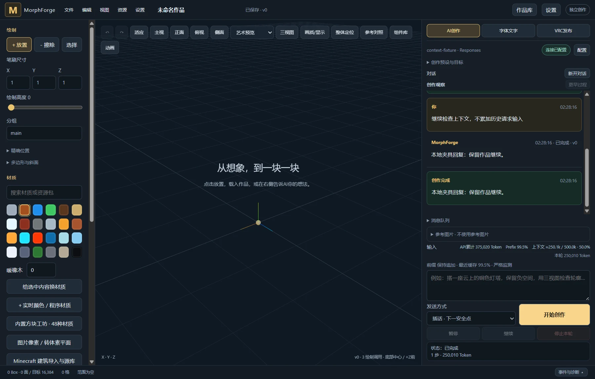

# 0.15.3：增量发布基准与上下文表盘

2026-10-21，gamepc 独立开发测试副本。主安装和主数据保持原状；本轮未上传 Avatar、未启用 Windows OSC、未发起真实付费模型请求。

## 增量比较的实际语义

MF6 的 `Session.boxes/triangles` 记录本机逐条成功写入 UDP 的对象；规划下一批时与这些记录比较，不与上一版草稿比较。发布 B 尚未发完时再发布 C，仍使用已发出的部分状态。`sentRevision` 只记录最近完整发包版本，不能代表部分发送状态，也不能证明 VRChat 接收成功。

本轮新增状态字段 `baselineKind=local_udp_sent`、`sentObjects`、`remoteAcknowledged=false`；界面区分当前目标、最近完整发包版本及本机对象记录。相同目标再次增量发布不会凭空重发所有对象；补漏应使用“保留显示补播”，或按需开启连续/周期补播。

没有多人 ACK，因此用户观察到的未更新块也可能来自丢包。无法凭本机 ledger 反推出实际 VRChat 场景；本轮修正不能作为多人完整同步的保证。

## 两个已复现的缺陷

1. **跨池删除历史覆盖**：同一位置、尺寸的对象先在池0出生，删除后重建到池1，再删除，原本只按几何键保存的删除历史会覆盖池0记录。早先删除丢失后，补播仍会留下池0旧块。改为按 `(pool, geometry)` 保存、追踪物理删除；继续保持先删后绘的补播顺序。
2. **MF6 手动补播入口错误**：底层支持MF6补播，但HTTP入口只允许MF5，界面操作返回400。现在允许MF5/MF6，仍拒绝同时请求补播和清空重建。

回归测试将规划帧编码、解码后送入独立的池内中心替换接收器，故意丢弃初始删除：修复前最终残留2个对象而期望1个；修复后两个池的旧副本都清除。另一个回归只发B的删除便切到C，验证与B相同但尚未发送的换色不会被漏掉。它们是确定性的协议模拟，不是真实VRChat客户端测试。

HTTP集成测试通过实际 `/api/publish` 验证手动补播：旧入口400，修正后成功；保留已发对象记录、不增加Clear，`remoteAcknowledged=false`。测试关闭UDP，手工提交ledger以验证HTTP边界。

删除历史沿用既有32768条上限；极长会话超出有界历史后，已淘汰删除无法补播，仍需“清空并重建”。

## 当前上下文占用

输入框旁及设置中的上下文区显示 `上下文 ≈250.1k / 500.0k · 50.0%`，1k=1000 Token，90%起提示警示色，超过100%不掩盖实际数值。

- 有适用的上游usage时：最近一次请求的输入Token + 此后新增历史的本地估算，包含已完成的模型输出/工具结果。
- 尚无校准时：估算历史、系统说明、工具及运行开销。图片/tokenizer影响精度，始终保留 `≈`；流式生成中的输出在完整响应后更新。
- 分母采用配置窗口与已发现的上游窗口中较小者。上游 `/models` 窗口持久化供重启后的闲置界面使用；下一次运行仍重新发现能力。
- compact清除旧校准；切换模型、服务、静态说明或图片策略时旧校准失效。不同对话各自保存。
- 不是累计计费用量，不把尚未生成的最大输出预算当作占用。表盘只读，不调用模型，也不会向模型消息/系统说明/工具插入统计元数据。
- 校准后的轮询只估算新增历史，不重复扫描整个长前缀。可选校准数据损坏时丢弃校准，保留完整对话；费用和前缀保护的严格校验不变。

画面与usage均来自本地合成Provider，非真实模型建模或计费结果。

## 验证

| 范围 | 结果 |
| --- | --- |
| Rust工作区 | 238通过、0失败 |
| Node前端单测 | 58通过、0失败 |
| Windows原生Chat模式 | 16项通过，见 [native-chat.json](native-chat.json) |
| Windows原生Responses模式 | 16项通过，见 [native-responses.json](native-responses.json) |
| 格式/语法 | cargo fmt、JS语法、git diff --check通过 |
| Clippy | advisory模式完成；严格 `-D warnings` 被既有material_wire.rs无效类型转换告警阻挡，本轮新增代码未留下新告警 |

原生脚本 `tools/check_publish_context_native.mjs` 在临时Tauri/WebView2窗口真实点击输入、发送、MF6补播按钮。两次请求分别报告125k、250k输入，当前上下文约250k，累计计费输入375k；上游500k窗口优先于配置1M。检查实际HTTP请求前缀保持追加、工具/静态说明保持不变、统计元数据不进请求、严格缓存检查仍启用；compact后不沿用旧输入校准。每种模式含一次compact，共3次本地夹具请求，真实付费请求0。

Windows x64 core与Tauri shell构建成功。开发测试副本安装到 `%LOCALAPPDATA%\MorphForge Preview\versions\0.15.3-a29beefe4af7`，桌面“**MorphForge - 开发测试副本**”指向新版本；旧版本二进制保留。安装仅更新副本current指针，未启动或覆盖主安装。

部署校验及主程序未改动证据见 [deployment.json](deployment.json) 和 [cleanup.json](cleanup.json)。主程序原有core PID210184、shell PID201512持续运行。临时验收窗口正常关闭，独立验收数据保留在gamepc用户临时目录，未合并到主数据或Preview数据。未创建GitHub Release。

## 后续主安装替换

同日用户明确要求“现在替换主程序版本”，随后使用正式NSIS安装包将主安装更新至0.15.3并启动。更新前主程序已关闭，无需结束运行中的任务。完整备份位于gamepc：

`C:\Users\Chiro\tmp\morphforge\main-backup-20261021-023544-f8105ab5`

安装前后全部6846个原数据文件、约1.36GB的组合指纹一致。安装注册版本、桌面及开始菜单入口、核心和shell有效载荷均通过校验。NSIS会修改shell的安装包类型标记，第一次误用target中的shell哈希校验未通过；随后独立解包安装器，确认安装文件与包内文件完全一致，再执行只读校验通过，无需重复安装。核心始终匹配已验收副本的同一二进制。

安装器SHA256：`4848de72828770ffbaa1faaa7f75ffbd4a19a3ae2568c3faa0018baa6a524f35`。

主程序实际启动返回0.15.3，新上下文表盘与补播控件可用，OSC保持关闭。启动后发生显式`new_project`工作区切换，验收保持当前新项目不动；通过存档核对更新前669 Box作品的完整场景、材质及原对话输入均保留。未复制开发副本数据、未调用模型、未发布Release。

见[主安装校验](main-install.json)及[启动和原存档核验](main-startup.json)。前文“主安装保持原状”仅描述之前副本验收阶段。
