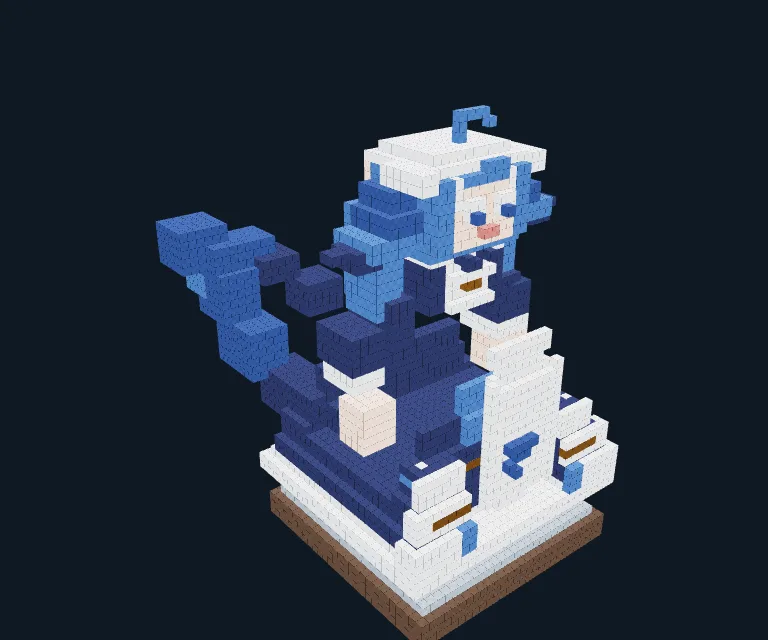

# 0.4.1 参考图建模迭代

日期：2026-10-19。运行时代码提交`cf8bcc7`，提示词`morphforge-system/4.3`，工具`morphforge-tools/3.1`。本轮改进是参考图复核、视觉历史大小和配色能力；不把生成成功或模型自评等同美术全部达标。

## 实现与自动验证

- 请求副本只保留每个视角最近一次作品截图，旧像素替换为revision/artifact说明。完整会话、源截图、参考图、compact和作品来源记录保留。
- Chat图片旁保留视角与revision标签。收尾提醒使用本地估算和最近实际输入的较大值，为必要修正、截图和看图后保存提前估计约三次请求的余量。提醒不强制模型遵从，也没有改变实际usage门限及最多一次完整响应越线的规则。
- `define_palette`一次定义1～32个`#RRGGBB`纯色，自动分配25～4095内未占用ID、同色复用，不改已有材质或几何，保留版本快照。解决默认24种材质没有肤色、藏蓝等参考图关键颜色的问题；新增颜色发布VRC前需更新Avatar目录。
- Linux Rust **103项**通过；Clippy `-D warnings`与格式检查通过。新增覆盖旧图省略、其他视角/参考保留、完整历史不变、实际视觉输入预算、色板去重、无效批次无部分写入与历史恢复。
- 真实Rust + Chromium + 本机Chat服务：原参考图流程**24项**通过，包含色板的完整流程**27项**通过，实际生成、截图、入库及读取保存的RGB和style ID，验证图片标签、参考取消和Token统计。[最终浏览器报告](browser-palette/provider-presets-browser.json)。

## 真实模型对照

鲸鱼娘各首次运行采用相同文字、两张参考图、standard/none、18步/300k Token，未指定随机采样参数，只有单次样本，不能据此声称稳定提速或统计显著改善。时间包含评测收尾截图和状态轮询。

| 运行 | Box | 请求 / 实际Token | 结果 |
|---|---:|---:|---|
| 旧system4.0首次 | 437 | 14 / 290,192 | 入库，但脸在背面、超过400 Box要求，美术未通过 |
| system4.2截图窗口与方向提醒 | 281 | 16 / 308,015 | 约63秒、无工具错误、入库；正面有脸和围裙，配色和轮廓仍不理想 |
| system4.3新增色板 | 223 | 15 / 321,403 | 约79秒；创建8色，肤色、蓝发和藏蓝裙可见，整数坐标错误3次重试后预算耗尽，未自动收尾 |
| system4.3接续只复核和入库 | 223 | 3 / 104,002 | 约10秒完成；几何与前轮完全一致，真实截图、色板、署名和来源保存成功 |
| 木椅参考，system4.3草图档 | 16 | 8 / 92,486 | 约22秒、无工具错误、入库；椅子轮廓和腿可见，靠背负空间仍不充分 |

证据：[4.2对照](whale-reference/report.json)、[4.3首次及失败](whale-palette/report.json)、[4.3接续](whale-palette-finish/report.json)、[木椅](chair-reference/report.json)。每个目录保存事件、最终几何、front/hero/top真实PNG。参考图没有充当作品截图，所有OSC连接保持关闭。

最终鲸鱼娘的独立人工检查只确认配色与正面识别点改善：蓝发、肤色脸、藏蓝裙、白围裙和侧后方尾巴可见。裙摆仍像层叠台阶、比例偏塔形、鲸鳍/分叉尾轮廓和手臂遮挡仍有问题；不标记为参考还原全部通过。模型最终summary也披露了简化。截图窗口限制成功生效，但本轮总Token**没有下降**；原始Recipe文本、重复修正和工具错误仍有明显开销。

这是依据ZipZipPipe绘制、上善无形原角色的参考图生成的非官方体素二创，图片及该二创遵循CC BY-NC-SA 4.0，不随项目代码改授MIT；[作者、原帖与许可](../../references/ATTRIBUTION.md)。

可通过工作台导入[完整作品JSON](whale-palette-finish/artwork.json)，直接查看/修改223 Box和32种材质，无需再次调用模型。JSON包含来源记录；截图artifact保存在同目录，导入几何不依赖原评测服务。

## 测试环境故障与隔离

首次并行编译替换了正在运行的`target/debug/morphforge`，Linux的`current_exe()`指向带`(deleted)`的原inode，导致Recipe子进程ENOENT。它不是OSC或模型API失败。原失败保留在[build-race](whale-reference-build-race/report.json)与[browser-build-race](browser-build-race/provider-presets-browser-failure.json)。之后使用独立复制的可执行文件运行评测，避免编译覆盖。

4.2评测二进制SHA256为`9d4e6ada7510555e9511d8d8b68ec43d89bfc650df5c477f84a7c07a8d5f7df6`；最终4.3评测二进制为`1ca0acb43bf7b50a1832bdb7d0a0d09ca07e88a661448130a931c5509f79ea76`。

## Windows候选

安装器`dist/windows/MorphForge Desktop_0.4.1_x64-setup.exe`由113项冻结输入构建；[冻结清单](source-freeze.json)对应提交`cf8bcc7`，构建前后hash完全一致。Windows核心和桌面**105项**通过，原生HTTP **62项**通过，8张内置图和8张缩略图hash匹配源码；安装器解包的核心与已验收核心一致，图片许可、署名及字体OFL全文匹配。[构建摘要](windows-build.json)、[HTTP](windows-http.json)、[图片](windows-references.json)、[安装器内容](installer-payload.json)。测试使用独立数据目录，不覆盖用户安装或作品，没有启动VRChat、发送9000或改Unity资产。

原生检查脚本新增可显式传入ExtraTools，保留旧版本12工具验证并支持本轮13工具，同时增加色板写入、同色复用和权威上下文RGB检查。初次调用的相对报告路径及旧脚本工具清单不适配问题已修正；没有因此跳过失败检查。安装器16,717,091字节，SHA256为`494bf0f8ca193d5be0758269b7bcdbc0ce00d64948366be066a5f25c9504cae7`。
