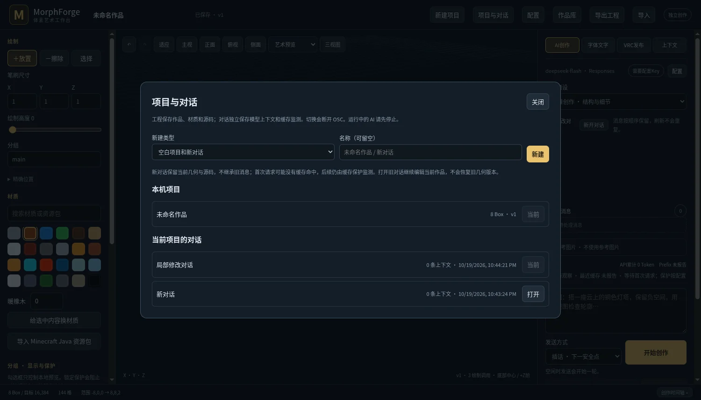

# 0.6.1：项目与独立对话管理

2026-10-19。按用户要求直接安装 gamepc；未创建 GitHub Release。此次实现范围是验收意见第 3 项，其余渲染/材质/坐标意见仅分析，见 [ACCEPTANCE-REVIEW.md](ACCEPTANCE-REVIEW.md)。

## 已交付

- 顶栏“新建项目 / 项目与对话”，AI 区“新开对话”。输入名称可留空。
- 空白工程与独立上下文；旧工程、旧对话均可打开。切回对话继续编辑当前作品，不回滚几何。
- 工程分别保存几何、材质、源码及快照历史；对话分别保存模型上下文、前缀检查及缓存保护状态。API/模型设置、作品库和物理资源目录共用。
- 切换会断开 OSC 和自动发布；已有发送目标不在此操作中清空。运行/暂停/停止中及排队任务未结束时拒绝切换。
- HTTP 写操作与工程切换互斥，截图结果提交可以继续完成；旧后台工作不能跨工程提交。
- 旧数据补上稳定项目/对话归属，事件日志原件保留，时间轴索引按工程过滤。对话的聊天/待处理消息/参考图 UI 状态分别保存。
- 切换保存恢复日志，进程中断后恢复一致的工程、上下文及缓存状态。损坏的上下文拒绝启动，不静默清空。
- 新对话首次可能冷缓存；切回旧对话恢复该对话已有的缓存告警，不能借切换自动确认旧告警。实际缓存是否仍在上游，由后续 usage 监测判断。

## 验证

| 验证 | 结果 |
|---|---:|
| Linux Rust 完整回归 | 147 通过 |
| Node 回归 | 36 通过 |
| Rust clippy（全部 targets，warnings 视为错误） | 通过 |
| 实际 Chromium 新建/切换/回看与布局 | 12 项通过 |
| Windows 原生工作区集成测试 | 4 通过 |
| Windows Release 核心强化回归 | 13 项通过 |
| 实际 gamepc 安装与数据保留 | 14 项通过 |

Windows 强化回归使用真实 recipe 子进程与截图 broker 的 PNG fixture，不将其描述为 Windows GPU 画质验证。浏览器点击与截图在 Linux Chromium 完成。未调用付费模型、发送 OSC 或修改 Unity 资产。现有 Harness 系统提示词/工具 schema 版本未变；0.6.1 未进行新的生成质量实验。

证据：[本地验证](local-validation.json)、[浏览器验证](browser/validation.json)、[Windows 强化回归](windows-quality.json)、[安装回执](gamepc-install.json)。

安装后的软件版本 **0.6.1**，当前作品 **791 Box / revision 17**。升级前后核对完整 scene 哈希与项目 ID 一致；`harness.json` 与已有 `provider.env` 内容哈希保持一致。升级前完整数据备份在 gamepc：`C:\Users\Chiro\tmp\morphforge\v061-before-upgrade-20261019-224944`。备份包含本地配置，留在 gamepc，未加入仓库。

安装包 SHA256：`6f919d68ec6176a3ebf4d6895c063413905c696f3921107d8a4116b14eb60988`。

当前安装作品使用 14 种材质，与 Unity 工程的 100 项源材质目录逐 ID 比较，使用中的材质无缺失、无定义差异；这不等于核实已上传 Avatar 的实际目录。见 [材质比较](material-comparison.json)。

## 限制

独立上下文以软件内可切换对话提供，不是多个独立原生窗口。多个网页标签页仍连接同一活动工作区；切换操作检查预期工程和对话 ID，旧标签需要刷新。普通绘制 API 延续既有 revision 检查，因此不建议多个标签同时编辑不同项目。切换项目后按快照重建撤销栈，重做栈不跨项目保存。源码与几何仍是独立版本，切回对话不会自动重建源码或回滚几何。

恢复日志覆盖进程中断，不承诺机器断电后的文件系统持久性。发生磁盘写入失败时保留日志供重启恢复；不把恢复机制称为跨文件系统数据库事务。
