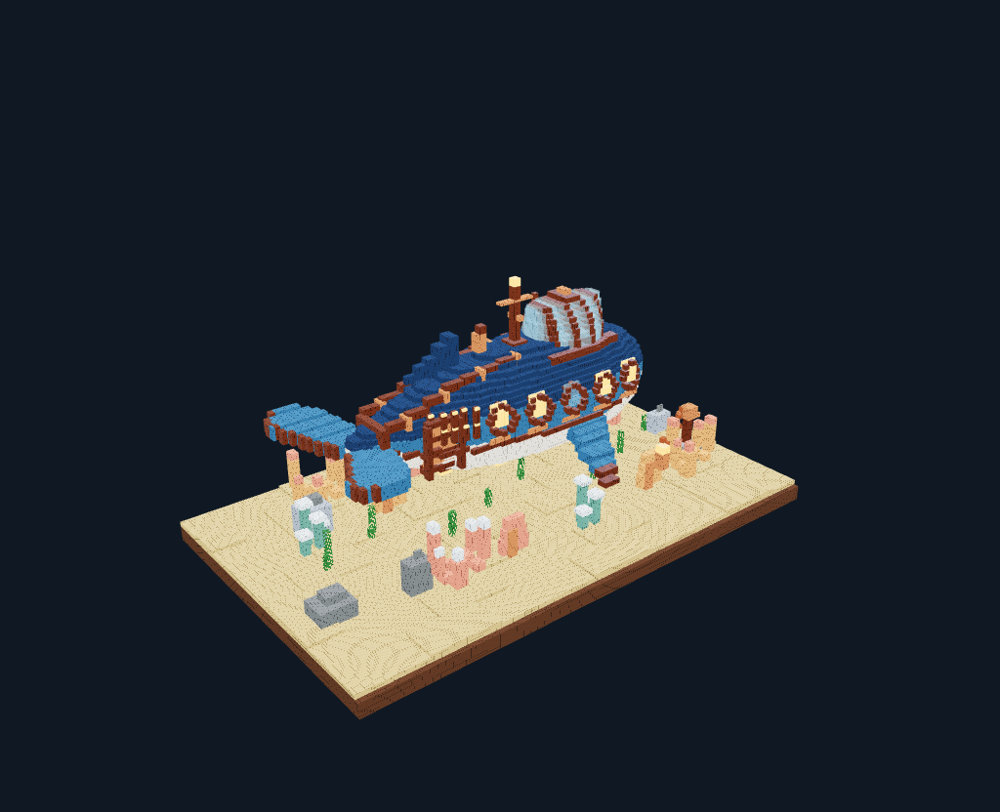

# 0.6.0 Harness强化迭代

日期：2026-10-19。最终接口版本：system4.8 / tools3.5 / recipe3。Windows候选及冻结记录在本目录。软件功能验证、真实模型结果和dsh对照结论分别记录。

## 实现范围

常驻前缀/上游缓存保护与暂停、严格模式输入预算预留、执行器故障停止；持久可回看的思考与操作时间轴；自由/局部/正交截图；绘制后直接返回截图；持久CommonJS源码、精确patch与不可变源码快照；曲面/扫掠/挤出助手、组移除、切片检查、artifact重读/裁剪。完成作品前检查当前图片是否真正进入过模型请求，避免同批次尚未看图便收尾。

默认1M上下文、384K输出保留，未改Avatar、OSC字段、Unity资产或实际上传。测试不向9000发包。模型思考只显示上游实际返回的文本/摘要，不推造未暴露的内部过程。[使用与API](../HARNESS-QUALITY-TOOLS.md)。

## 真实模型费用与第一轮失败

开发原型先做两次受限官方API请求，只确认缓存：第二次实际输入9,071、命中6,656，约73.4%。[报告](cache-probe/report.json)。随后同一上下文开始从零创作鲸鱼潜航器，缓存保持正常：5次请求输入162,474、缓存149,632，约92.1%；输出38,967。

这轮**失败**，不能称为一次自动完成：新增源码模块首版使用动态Function，复杂模型源码触发Boa内部panic；后续出现SOURCE_CONFLICT，模型最后退回直接Recipe生成1,615 Box。未完成模型看图复核、commit或入库。[原始输入](../../evaluations/harness-v6/r1-whale-submarine.json)、[失败报告](r1-whale-submarine/report.json)、[事件](r1-whale-submarine/events.jsonl)。

原型总Token预算设置160,000，实际201,441：旧预算只按剩余总量限制输出，没有为下一请求的输入预留，导致最后一次可预见的输入越界。这是本轮发现并修复的缺陷，不将其隐藏为正常收尾，也不把高缓存率等同没有费用。

首轮和首次探测合计7次请求、217,240 Token；后续一次受限探测与看图修正详见下节。记录来自真实usage，没有价格配置时不虚构金额。[费用与前缀汇总](paid-usage.json)。所有本地fixture的95%等模拟数字均排除在此汇总之外。

## 离线修复与原样恢复

保留原模型生成的11KB源码作为回归fixture，旧二进制离线重放稳定复现 `must be declarative environment`，返回码1，[负对照](runtime-replay/negative.json)。新加载器生成静态模块工厂，移除动态Function，支持相对require；同一源码原样通过。新增内部执行器故障暂停，避免模型反复付费重试平台错误；文件hash冲突说明和精确patch也已补强。

严格模式已改为为预计输入预留预算后再分配输出，compact同样预留输入且不能绕过现有缓存暂停。估算仍可能有误差，最终按真实usage记账，不承诺精确货币上限。

在另一个**不发模型请求**的隔离工程恢复原始源码，生成1,636 Box、406,858占用格并渲染真实三视图。[恢复报告](runtime-recovered/report.json)、[可导入工程](runtime-recovered/artwork.json)。这不是新的自动生成或模型视觉复核，也不修改首次失败的几何与报告。

## 第二轮：真实看图修正与API格式反馈

使用最终化前的system4.7/tools3.4，再次探测实际缓存命中后，仅复核恢复好的草稿。模型调用真实截图和分组检查，随后使用`mf.voxelize`修改鳍，自动返回修改后的三视图，形成1,661 Box。看图→修改→新截图成立，但新的严格输入预算检查在下一响应前停止，未完成模型最终复核/commit/入库：[报告](r2-fin-review/report.json)。探测与该轮合计72,699 Token，低于事先设置的100,000目录限额。

这轮第一次把views和shots一起传入，旧提案“二选一”造成一次可避免的工具错误和重试。最终tools3.5/system4.8改为支持预设与自定义视角组合、同名覆盖，使用这次原始参数做离线重放，不为修复格式再花钱调用模型。[原始组合请求](capture-mix-replay/input.json)。

最终累计真实请求12次、289,939 Token：缓存输入204,160、未缓存输入39,103、输出46,676，其中reasoning 30,108。两组会话普通请求前缀均保持追加；真实上游每次接续均有正缓存报告。详情见[费用记录](paid-usage.json)。此后不再追加付费测试。

助手人工看过最终图片后只做本机保存，便于用户直接测试；这不是模型自动收尾，原报告中的失败和未入库结论不修改。[可导入当前草稿](r2-fin-review/artwork-manual-save.json)、[人工保存回执](r2-fin-review/manual-save.json)。源文件与直接几何修改分开保存，原main.js并不会自动包含这次局部Recipe；后续应继续完善源码与几何版本的一致性。

## 离线与浏览器验证

首版真实Rust/Chromium整链路19项通过：[报告](browser/report.json)。测试使用本地协议fixture，覆盖源码写入/运行、dry-run、参数修改、切片、局部/正交相机、图片裁剪、流式思考可见、真实截图入库、追加式上下文、HTML文本安全、密钥脱敏、历史预览不编辑工程、零命中暂停。

后续最终回归另存 `browser-final`，进一步覆盖精确patch、绘制+截图合并、执行器故障暂停及已暖机缓存首次丢失立即暂停；Chat/Responses图片SSE前缀检查另存 `prefix-chat` / `prefix-responses`。Rust/Node与Windows结果以最终记录为准，不以早期开发二进制的通过替代最终验收。

## 最终Linux验收

[143项Rust、36项Node](linux-validation.json)、格式检查、Clippy `-D warnings`通过；[最终浏览器23项](browser-final/report.json)、[Provider/参考图/色板27项](provider-browser/provider-presets-browser.json)通过。Chat与Responses图片SSE各16项、11次请求的透明透传回归通过，普通阶段追加、compact明确重置后继续追加：[Chat](prefix-chat/report.json)、[Responses](prefix-responses/report.json)。

[真实模型先前被拒的混合相机参数](capture-mix-replay/report.json)已在不发模型请求的服务中原样渲染三图；历史截图rev3与当前编辑rev4分别标注，版本回看不修改当前工程。时间轴包含实际上游思考的[离线回放截图](timeline-real-replay.png)；没有为了截图重新付费生成。

## Windows与安装器

使用[155项冻结输入](source-freeze.json)构建，构建前后及最终校验一致；Windows核心/桌面 **145项**、[HTTP 62项](windows-http.json)、[强化功能13项](windows-quality.json)通过。原生补充检查覆盖中文相对模块、精确patch、真实工作子进程、绘制+混合截图broker、历史读取和输入预算拦截；broker使用固定PNG协议fixture，实际相机像素由Chromium检查覆盖，Windows真实显卡与VRChat多人效果仍待用户现场验证。

[8张参考图及缩略图](windows-references.json)、[6份作品和18张视图](windows-examples.json)字节匹配；安装器解包核心与已验收Windows核心hash完全相同，8份许可/署名匹配源文件。[构建摘要](windows-build.json)。NSIS安装器17,351,411字节，SHA256 `0650eba8d7e9f0d77e7ee7dbca26b91f29ccc2d63a4e9c4fd9bf2fa86d8ce16f`。保留已有Tauri STATIC_VCRUNTIME弃用提示，构建成功。

Release另附 `MorphForge-0.6.0-whale-draft.zip`，解压并导入artwork.json即可离线查看1,661 Box和完整材质，不必再次生成；标注人工保存和MIT许可。本轮没有覆盖用户安装或默认数据目录。

## 与dsh的比较边界

本轮已按真实失败迭代工具和执行链，但没有取得用户实际dsh版本、原始同题轨迹和相同预算的多次配对结果，不能宣称已经追平或超过dsh。1,636 Box也不是美术评分。当前作品有可辨的蓝白船体、舷窗、驾驶舱和海床，鲸鱼轮廓、鳍与尾部造型仍需复核。下一轮应使用完整视觉循环的足够预算和同题盲评，记录缓存输入与真正收费更相关的未缓存输入/输出，避免仅用总Token比较费用。

[计划与阶段门槛](../plan/HARNESS-QUALITY-ITERATION.md)。
