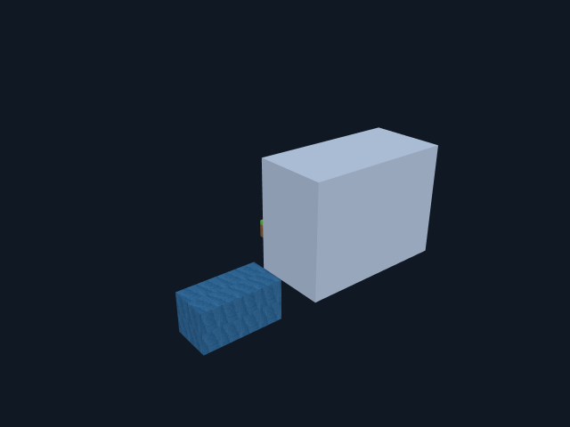

# 0.7.0：画质、材质、整体定位和透明表面

2026-10-20 完成。按验收问题 1、2、4～10 实施；第 3 项项目/对话管理沿用 0.6.1。只向 gamepc 开发测试副本部署，原验收版保持 0.6.1，未发布 GitHub Release。已运行的旧副本不会被强制关闭，关闭重开后使用新版。

## 对照验收意见

| 编号 | 本版实现 | 测试及边界 |
|---|---|---|
| 1 | 观察默认 2× 像素采样、标准档可降低负载；截图默认 2× 超采样后缩到请求尺寸，工具允许 1～3×。纹理六面/帧使用独立数组层、mipmap 和各向异性过滤，UV 导数使用未取 fract 的坐标。 | 实际 WebGL 六面颜色、动画顺序和相位回归通过。超过纹理层/内存预算的超长动画保留最近邻图集回退，并在截图回执报告；总截图缓冲限制 16M 像素。 |
| 2 | 发布区间、完整包围盒、越界组、容量和居中建议可见；可显示 VRC 256³ 边界。 | 创作继续允许有符号大坐标。负 X/Z 在目标范围内有效；Y<0 或尺寸超界不静默裁剪，显示缩放不扩大坐标编码。 |
| 4 | 内置原创、MIT 许可的“像素工坊”19种 16×16 材质：木石、草土、砖、沙雪、树叶、云水、玻璃、金属和发光。可仅加入色板，也可替换作品的基础材质。 | 完全离线；水有帧动画，草/木有六面区别。原版 Minecraft 素材未加入，现有 Java ZIP 导入保留。新增材质需要重建 Avatar 目录。 |
| 5 | 网页和 Unity Shader 默认去掉边框/四宫格；可选抗锯齿观察格线，截图是否含格线单独控制。 | Unity 的新格线属性默认为 0。已上传的 Avatar 需更新 Shader 后才体现。 |
| 6 | 可导入目标 Avatar 的 catalog JSON/ZIP；对已使用的材质逐 ID 比较 UID 和渲染定义，显示指纹、缺失/差异；已声明但不匹配的目录阻止发布/开启发送。 | 无目录时明确“未核实”；不假装得到远端 Avatar 确认。配置损坏保持阻断，不能静默变成未知状态。 |
| 7 | 模型截图工具增加 art/vrc、quality、supersampling、voxelGrid、surfaceCulling；保留最多5个混合自由/预设视角、局部取景与历史裁切。绘制附带截图采用同一参数。 | 非法画质在几何执行前拒绝；结果带实际采样倍率、渲染模式、内部面统计和回退警告。画质设置保存在 Rust 数据根，跨随机端口和重启保留。 |
| 8 | 新增模型工具 transform_scene：整体平移、落地居中、dryRun；UI“整体定位”先看偏移/边界再应用，支持撤销。可选 AI 完成前自动居中。 | 不改 Recipe 源码；不每一步自动移动。完成时产生新 revision 必须重新截图复核。受保护分组阻止定位，陈旧 revision 不会应用。 |
| 9 | VRC 预览及 Unity Shader 采用作品局部坐标中的固定太阳、半球环境和简化高光/发光，避免随场景灯光变化。 | 隔离 Unity 实际像素验证世界灯光变化不影响结果；这是局部近似光照，不是体积渲染、全局照明或实际 VRChat 客户端抓图。 |
| 10 | 按同材质/染色的连续介质计算内部界面，只有完整覆盖才剔除；部分覆盖做矩形联合检查，复杂度超限保守保留。网页透明实例按相机深度排序。 | 隔开的透明物体仍可见，不能只凭 alpha 一样跳过。隐藏分组时暂停预览剔面，避免缺口。VRC 通过显式目录能力复用透明材质的6-bit相位通路编码遮面，不新增同步位。 |

## 使用

1. 关闭旧的开发测试副本，再从桌面 **MorphForge - 开发测试副本** 启动，窗口标题应为 **0.7.0**。
2. 观察默认更清晰且没有格纹；“画质/显示”可切换标准/精细、观察格线、截图格线、内部面和目标边界。
3. 左侧“内置像素工坊”加入主题；勾选替换选项才改变现有作品基础材质。VRC 目录导出会包含主题许可。
4. “整体定位”预览后应用；VRC 页可以打开完成前自动居中。建议在最终视觉复核前手动定位，减少重复截图。
5. VRC 页导入已经用于构建目标 Avatar 的目录，检查已用材质是否匹配。只导入某个文件不证明当前上传的 Avatar 确实使用该目录。

## 兼容与开销

- MF3 仍为 56 bit；没有增加同步参数、Animator 层或粒子容量。
- `transparent-face-mask/1` 是显式目标能力。仅在用户导入带此能力的目录后，发送端将透明 Box 的相位6位变为面遮罩；透明动画采用统一相位，原艺术工程的 motionPhase 保留。未知目标/旧目录仍沿用旧编码。
- Shader 只有在新目录对应 metadata 标志存在时读取面遮罩。重新打包并上传配套 Avatar 后才能获得 VRC 新材质、mipmap、虚拟光照和剔面效果；本任务未上传 Avatar、未运行真实 VRChat。
- 全部隐藏的内部透明 Box 可在目标投影中省略，后续编辑会重新计算并补回。源体积和源码不删除。额外遮面变化可能增加刷子命令数，发送进度按实际队列估算。
- 网页的透明实例排序、内部面剔除改善相邻积木；不同透明材质交叠、相互穿插和体积折射仍非精确光学渲染。
- 完成前自动居中默认关闭。整体定位不改写源码，重新 replace 源码会回到源码坐标。

## 上下文与费用

系统提示词 `morphforge-system/4.9`、工具 `morphforge-tools/3.6`。由于静态前缀改变，旧对话会提示升级或新开；未知来源的旧上下文同样阻止静默升级。显式升级保留原历史、授权静态前缀变化，仍需重新预热。已有缓存告警不能通过升级绕过；大上下文建议新开对话避免整段冷输入。

本轮只使用本地模型协议 fixture，真实付费生成请求为 **0**。Chat 与 Responses 经透明代理各完成 16 项、11个本地请求的图片/SSE前缀回归；这些证明实际出站上下文追加性，不冒称真实上游缓存命中。实际 usage 的缓存监测/预算保护保留。

## 验证与修复记录

- Linux Rust 完整回归 156 项；Windows Rust 完整回归 156 项；Node 38 项；Clippy 全部 targets 无 warning。
- 最终实际浏览器 25 项，包括自由相机、2×截图、目录不匹配拦截、独立层 mipmap 和遮面像素等价探针。
- 实际纹理 framebuffer 回归验证动画顺序/插值/相位、+Z/+X/+Y六面方向及增量更新。
- Unity 隔离资产构建和实际 Camera.Render：43材质、132数组层、6级mipmap；虚拟光照、可选格线、遮面通过，生产材质GUID未改变；实际 MetadataGrid Shader 变体与主 Shader 像素一致。
- Windows 实际桌面核心和实际截图 worker 13 项通过；没有把 PNG 协议 fixture 当作实际画质验证。

首轮 Unity 采样宏在当前管线不可用，改为实际支持的 SampleGrad 后通过。隔离测试相机最初没有显式绑定预览场景，首轮像素无效；改为绑定 Preview Scene 后重新取得有效结果，没有把错误相机输出纳入交付图片。

Windows 实图人工检查发现遮面碎斑：浮点 varying 直接取整会将 `2` 的微小插值误差解成 `1`，误剔除可见面。修复为先舍入遮面码，再取位。真实 GPU 等价探针从 **3,743 个不应变化的像素 → 0**，并加入浏览器回归。早期截图和报告保留为 before，不作为最终画质结论。

证据：`browser-frozen/validation.json`、`mask-rounding-before.json`、`materials-webgl/webgl-validation.json`、`prefix-chat/report.json`、`prefix-responses/report.json`、`unity/validation.json`、`windows-runtime.json`、`preview-install.json`。最终画质和目录源仍需用户在自己的工作内容及真实 VRChat 中进一步验收。

源码冻结与构建输入：source-freeze.json。部署采用不可变版本目录，预览启动指针和实际核心SHA256记录在 preview-install.json；用户正在运行的原验收版及旧副本保持原进程。
