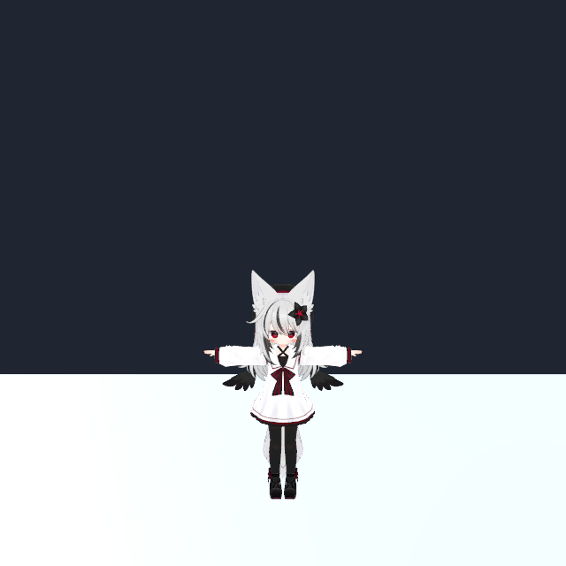

# MorphForge 环境配置验收

完成日期：2026-10-18，北京时间约 16:06。Unity 工程为 `D:\Projects\VRChatProjects2\MorphForge`，Editor 2022.3.22f1。

## 完成内容

- 建立独立的 SSH → PowerShell → Unity CLI/Pipeline 工具，所有 Unity 命令显式选择 MorphForge。
- 复用 Roadster 的 Unity 2022 Pipeline 适配包，保留 Mono.Cecil、Roslyn 导入与编辑器兼容修订。
- 保留原工程 SDK Base / Avatars 3.10.5。
- 导入 Nemesis 及其原 `.meta`，核对基础 Prefab SHA-256；共复制 888 个资源/元数据文件。
- 依据 Nemesis Prefab 集的实际依赖，导入 lilToon 2.3.4、Modular Avatar 1.18.7、NDMF 1.14.8、Supine 5.1.0；另准备 Gesture Manager 3.9.9。
- 在当前登录桌面启动独立 MorphForge Editor，启用 Auto-tick。按需启动任务没有定时触发器。
- 通过 Pipeline 保存 `Assets/MorphForge/Scenes/MorphForge_Nemesis.unity`，包含 Nemesis 实例、地面、灯光和预览相机。

## 检查结果

| 检查 | 结果 |
| --- | --- |
| Pipeline 目标工程 | MorphForge，实际端口 7801，工具按项目动态发现 |
| Editor 状态 | ready，未编译，Edit Mode |
| 准备脚本编译和执行 | 通过 |
| Nemesis Humanoid | 有效 |
| Avatar Descriptor | 有效 |
| Missing Script | 0 |
| 缺失依赖 | 0 |
| 材质 Shader 缺失/不支持/错误替代 | 0 |
| SkinnedMeshRenderer / Renderer | 19 / 19 |
| Editor 包版本查询 | 9 个相关包，版本与配置一致 |
| 预览图 | 已渲染并查看，模型正常显示 |

报告：[资源导入](bootstrap.json)、[模型与依赖验证](validation.json)、[最终 Editor 状态](editor-status.json)。

验证范围是 Editor 环境和导入后的基础资产；未进行 Avatar 上传、VRChat 客户端、OSC 传输或几何/动画原型测试。
