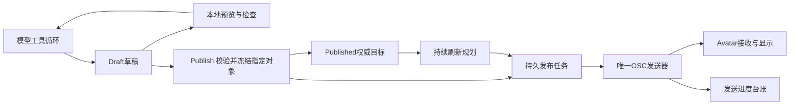

# 快速仿真、草稿提交与独占OSC发送设计

> 本页保留早期设计及当时实现状态；当前Rust调度器、AI、截图和周期刷新实现见 [架构](../plan/ARCHITECTURE.md)、[用户指南](../USER-GUIDE.md)及[实施状态](../plan/STATUS.md)。

日期：2026-10-18。状态：可评审设计，尚未实现仿真程序、模型接入、发布调度器或周期刷新。现有Unity几何原型不具备下述系统能力。用户本轮要求：模型快速在仿真环境编辑/截图，阶段性异步提交；发送独占MorphForge通道；外部维护草稿与提交两套体素空间；完成后持续刷新供晚加入者恢复。

本设计延续 [体素与运动协议](../voxel-capacity/README.md)，不在此定稿共享通道数量或分片位布局。配置样例见 [design-config.example.json](design-config.example.json)，模型指令见 [model-instructions.zh-CN.md](model-instructions.zh-CN.md)。

## 1. 两个可编辑空间与一份发送台账

| 数据 | 职责 | 写入者 |
| --- | --- | --- |
| Draft草稿空间D | AI当前设计、快速建模、试错、截图 | 草稿场景服务 |
| Published提交空间P | 系统已接受、应最终呈现在VRChat中的权威目标 | 发布服务 |
| Delivery发送台账 | 哪个对象/修复单元的哪个版本已排队、已发送或待修复 | 独占发送器 |

台账不是第三套可编辑体素世界。它记录已发快照引用和命令进度；P的历史版本是不可变快照，可按内容/块共享，不要求每次复制整场景。

Published不是“所有玩家已经显示”的证明。入队、发送完、拥有者本机显示、各远端显示是不同状态。首版不假设存在所有观看者回执，界面只显示可证实的状态。

对象用稳定objectId，体素记录仍含逻辑坐标、样式、染色和运动组；空间分区/显示缓存单元与对象ID分开。改屋顶只提交屋顶，未发布的其他草稿不进入P。

## 2. 流程



模型只调用建模、预览和Publish工具，不直接写MF_*参数、不持有OSC锁、不等待网络节奏。发送器与模型编辑/预览并行运行。

0.2s只是沿用的状态保持规划值，不是本机OSC的硬性最小间隔。官方自定义参数通常采用Playable同步，更新约0.1–1s，实际采样、保持、重发与命令执行时长需要测量。

## 3. 快速仿真器

首版使用稀疏体素数据与独立本地渲染视图，建模操作不受OSC节奏限制。可用浏览器/WebGL交互视图加离屏截图服务，技术框架待实现时选择。界面提供草稿、提交目标与发送进度三个视角；第三项由版本/台账推导，不建立另一个可任意编辑的世界。

模型使用FillBox、EraseBox、ReplaceStyle、TransformObject、Repeat等批量工具快速编辑，而非逐块生成长文本。预览支持固定等距、正面、顶部相机及对象框选；返回图片、相机信息、draftRevision和objectVersions，使截图与评估明确对应同一快照。

预览采用同一套网格坐标、样式表、资源包、运动公式和协议量化。虚拟时间可冻结或快进，用于观察动画。仿真画面不等同于实际VRChat的光照、阴影或接收成功；不假定外部程序已能读取VRChat网络时钟。

Inspect返回：非空体素数、对象包围盒、越界/未知样式、运动组引用、预计粒子容量和双版本峰值、待发布差异与发送时间估计。发布前验证接收器manifest支持这些功能。

外部FillBox只是快速生成草稿的工具。粒子Avatar尚无批量出生解释器时，发送层仍展开为逐体素记录；不能把外部一行工具调用算成一次OSC造出整堵墙。

## 4. 快速整合函数Publish

建议唯一发布入口：

```python
Publish(
    scope=["base", "roof"],
    sourceDraftRevision=42,
    presentation="progressive",  # 或接收器支持的staged
    queuePolicy="latest",
    wait=False,
)
```

scope为空可表示发布全部已校验草稿，作为SyncDraft/PublishAll快捷入口。默认异步，不等待OSC。

流程：

1. 获取所选范围的不可变草稿快照，同时固定其样式/运动依赖。
2. 验证已选对象版本与当前草稿是否冲突；其他对象的并发编辑不构成冲突。
3. 合成所选对象与P中其他对象，校验逻辑格最终结果和整体/暂存峰值容量。
4. 在短持久事务内更新P的版本指针，并插入发送outbox任务和发布事件。
5. 返回commitId、捕获的草稿版本、P版本、增删改统计、排队位置与时间估计；模型立即继续编辑其他对象。

只有发布选中范围进入P。发布失败不部分覆盖P，也不删除D。删除对象时先合成其他对象对同一格的占用，再决定最终是清空还是恢复底层对象，不能按对象包围盒无条件擦除一切。

Publish从不可变快照构建任务，发送时不读取正在变化的D。模型后来将屋顶从版本4改成5，不会改写已经捕获的屋顶4任务内容。

## 5. 队列合并与基线

默认latest：尚未开始、同一范围的多个任务合并为最新完整目标；不同对象可继续排队。若需要完整施工阶段，显式使用ordered，保留阶段顺序和依赖。

不能简单丢弃旧任务后只保留最后一次差异。例如P1新增100块还未发送，P2只改其中1块颜色；若删除P1任务而只发P1→P2差异，会漏掉其余99块。

因此任务保存完整范围目标快照；真正执行前，相对发送台账所引用的已发基线重新编译操作。传输中部分完成的命令也记入台账，以便取消或重规划时补偿。台账是发送器对已发状态的估计，丢包后仍要靠权威刷新修复。

已开始的渐进任务可在完整命令边界转向更新目标；不能在Prepare/Execute或擦除/发射中间切走。已经开始的staged事务默认固定版本并完成，再处理该范围的后续最新目标，避免连续编辑使后台版本永远不能显示。完整事务内的上下文/银行隔离以接收器能力为准。

对象依赖例如地台→柱子→屋顶，以任务依赖记录。上游任务被合并时依赖要指向满足要求的替代目标，不留下永远等待的旧jobId。

## 6. 唯一写入者与独占范围

只有一个TransportWorker能写MorphForge的MF_*参数。AI任务、Publish和刷新调度都只创建任务，不直接使用OSC发送函数。

独占范围是MorphForge共享参数，不是禁止面捕或其他应用使用OSC。它们可以继续写各自参数；共享的VRChat同步预算与实际采样影响仍需实测。

发送器按完整传输命令持有数据与控制写入权；若接收器依赖当前编辑范围/后台版本上下文，则整个不可拆事务也需独占，不能交错别的范围。首版不假定当前8bit控制头支持任意交织的多事务。

刷新按小修复单元拆分，在完整事务边界让出通道给新发布。最大独占时长是调度目标，不能强行中断一个尚未安全结束的原生操作。AI继续工作不需要等待该锁。

## 7. 发送优先级与防饥饿

调度顺序：传输会话恢复/必要初始化、前台发布、后台刷新。前台繁忙时可以按约80%前台/20%刷新分配服务机会，并为刷新设置最长等待；空闲时刷新使用全部可用机会。

百分比按完整可让出的事务估算，不是强制把一条命令切成80/20。修复单元过大时应先细分，或明确显示长事务占用。用户前台持续提交不能让刷新永远停摆。

默认合并latest任务降低积压。队列超过时间预算时向模型/界面返回预计延迟，并继续允许D编辑；不静默丢掉用户要求ordered保留的阶段。具体积压阈值是配置候选，不是实际性能结论。

## 8. 周期刷新与晚加入恢复

刷新服务独立于模型Run，模型完成后仍运行。它不依赖模型记得再发一次，也不假设Avatar OSC提供任意房间中所有玩家加入通知。

正常刷新持续轮转覆盖受管理空间单元。每个单元读取当前P版本并冻结，生成绝对状态修复任务，完成后移动游标；单元发生新提交时标脏，只重排该单元，不因其他对象变更而重启全世界扫描。

需要同时处理：当前非空格、已删除格、已删除对象/运动引用、空分区。只反复发送非空块不足以修复漏收删除的旧客户端。

候选修复策略：

- 简单重发：SetVoxel完整覆盖并带必要的删除记录。较少全区闪烁，但依赖长期删除覆盖信息。
- 区域权威重建：清空一个受管理小区域，再重发该区域所有对象的合成结果，包括空区域。可修复旧残留，但渐进版本会有短暂空缺。
- 隔离后台版本重建后切换：显示效果更完整，依赖粒子双版本、擦除隔离和收齐判据，尚未实现。

首版可以验证渐进权威修复，再决定双版本方案。刷新使用绝对Set/Erase，不对未知状态累加发射或相对移动；重复命令必须按既有粒子删除/重建策略评估重复与Ring Buffer行为。

刷新任务绑定P版本。若它尚未执行就已过期，应重新规划；若执行途中同范围出现新版本，应完成当前不可拆边界后废弃剩余旧操作，重修最新目标，不能在前台新版本之后继续回放旧快照。

不在固定计时器每隔几秒无条件塞一份全量快照，避免队列无限增长。一个刷新游标/单元任务完成后再安排下一份，受优先级和配额控制。

持续刷新能在稳定目标、持续接收和受管理覆盖条件下帮助恢复，不保证任意损坏状态或持续丢包必然在固定时间内收敛。未知地址的错误粒子可能需要完整清空重建；提供手动Resync及传输会话重建后的强制完整恢复。

## 9. 需要补充的接收协议能力

只靠现有8bit控制字的4bit序号，不能证明晚加入者收齐一个对象，也不能识别任意跨场景迟到数据。要实现“完整后才显示”，需要进一步定义snapshotId、范围/版本、页号/条数、接收完成判据及提交门控。

这些元数据可以放扩展命令/数据包头，不一定每个都新增永久同步参数，但确实占数据吞吐和接收缓存。不能把本设计的发布事务与此前基础Prepare/Execute bit混为一谈，也不能把两个后台数据库空间当作Avatar已经有事务缓存。

没有远端ACK时，前台只标注已发送，不显示所有人已同步。若将来增加本机接收回执，其证明范围也仅是本机，不自动代表所有观看者。

## 10. 刷新速度预算

下面是两网络时隙的保守对照方案，不是协议最低成本或实测上限。[吞吐复核](throughput-audit.md) 将控制字大小与阶段等待分开，列出单状态、同描述批次等5/10/20块/s理论档位，均待验证。

后续 [长方体粒子](../voxel-capacity/cuboid-particles.md) 提案可将规则体素区编译成较少盒体。若该显示后端成立，ETA应按盒体/拆分/删除命令数计算，而非继续按逻辑体素数套用下表。

沿用每条最多2块、Prepare与Execute各0.2s，且没有重复、额外等待的理想假设：每条0.4s，约5块/s。

| 非空体素数 | 只写体素的理想时间 | 繁忙时刷新仅占20%的时间下界 |
| ---: | ---: | ---: |
| 256 | 51.2s | 256s（约4.3min） |
| 1024 | 204.8s | 1024s（约17.1min） |

未计入区域清空、运动配置、分片、重发与事务开销；稀疏分布也可能增加修复单元数。模型结束且前台队列排空后，刷新可用全部服务机会，因此1024块的理想一轮约3.4分钟起，非每10秒能刷完。

后来加入者可能要等待后续轮转或下一完整快照，恢复延迟随规模、修复方式和带宽增加。该架构隐藏生成等待、减少无效历史发送，不会提高VRChat本身的同步吞吐。

## 11. 模型工具API

| API | 返回/行为 |
| --- | --- |
| draft.create_object / apply_batch | 修改D，返回对象版本和草稿版本 |
| draft.fill_box / erase_box / transform / set_motion | 仿真内快速批量建模，暂不发OSC |
| preview.render | 指定D或P版本、多视角截图，可固定虚拟时间 |
| preview.inspect | 几何/容量/样式检查及发送成本 |
| publish.submit | 指定对象或全部，冻结快照并异步入队 |
| publish.status | 目标版本、已发进度、积压、ETA、刷新覆盖 |
| publish.sync_all | 快捷提交所有尚未发布的合法草稿差异 |
| run.finish | 检查/提交剩余目标，标记模型完成；发送与刷新继续 |
| transport.pause / resume / resync | 控制后台传输；暂停不撤销P，resync面向当前P |

旧例中的Avatar侧BeginEdit/CommitEdit由发送编译器按presentation生成，模型不手动驱动底层阶段。草稿本地编辑结束、Publish接受、Avatar可见版本切换分别记事件。

Publish支持显式阶段提交；自动流式发布可作为可选策略，只对标为可发布且验证通过的范围进行去抖合并，不把所有试错草稿默认公开。

## 12. 模型调用示例

```python
draft.create_object(objectId="base")
draft.fill_box(objectId="base", min=[124, 127, 124], max=[130, 127, 130], styleId=1)
shot = preview.render(source="draft", scope=["base"], cameras=["iso", "top"])
preview.inspect(scope=["base"])
c1 = publish.submit(scope=["base"], sourceDraftRevision=shot.draftRevision,
                    presentation="progressive", wait=False)

# c1发送时，模型立即处理下一部分；不等待OSC。
draft.create_object(objectId="pillar")
draft.fill_box(objectId="pillar", min=[124, 128, 124], max=[124, 139, 124], styleId=2)
shot2 = preview.render(source="draft", scope=["pillar"], cameras=["iso", "front"])
c2 = publish.submit(scope=["pillar"], sourceDraftRevision=shot2.draftRevision,
                    presentation="progressive", wait=False)

# 模型停止工作，不停止后台发送/刷新。
run.finish(publishRemaining=True, waitForDelivery=False)
```

## 13. 持久化、恢复与验收

可沿既有Python服务/SQLite草案落地：对象与稀疏块、D/P版本指针、不可变快照、发布outbox、发送命令日志、刷新游标和构建manifest。数据库事务同时更新P与outbox，OSC等待放在事务外。

重启保留D与P。正在发送的任务标记需核对，不盲目从头执行陈旧修改；基于当前P规划恢复。切换Avatar/协议manifest不匹配时先暂停写入，重新建立对应能力与恢复计划。

应验证：

1. 快速构建、固定版本截图与独立慢发送互不阻塞。
2. 发布A后继续修改D，发送A仍是冻结内容。
3. 同范围未开始任务合并，不漏旧任务的新增内容。
4. 删除、改色、撤销通过新P目标修复；取消发送不被误当撤销发布。
5. 刷新与前台发布不交错同一命令，不把新版本覆盖回旧版。
6. 模型完成后刷新仍持续；晚加入/漏删除/重载可按指定条件恢复。
7. 改变采样节奏、丢重复帧、遗漏Prepare/Execute后能检测或靠恢复修复，不宣称严格一次或全玩家确认。
8. 组配置、区域隔离与双版本峰值容量按真实Avatar能力验证。

## 来源

- 本项目既有 [多轮后端草案](../../../vrc-ai-world/docs/05-backend-design.md)。
- VRChat Animator Parameters：https://creators.vrchat.com/avatars/animator-parameters/ （自定义参数的状态同步性质和更新范围）。
- VRChat OSC Avatar Parameters：https://docs.vrchat.com/docs/osc-avatar-parameters （拥有者参数入口和Avatar切换配置）。
- SQLite Atomic Commit：https://sqlite.org/atomiccommit.html （仅用于本地发布/outbox持久事务，不将其扩大解释为网络原子性）。
