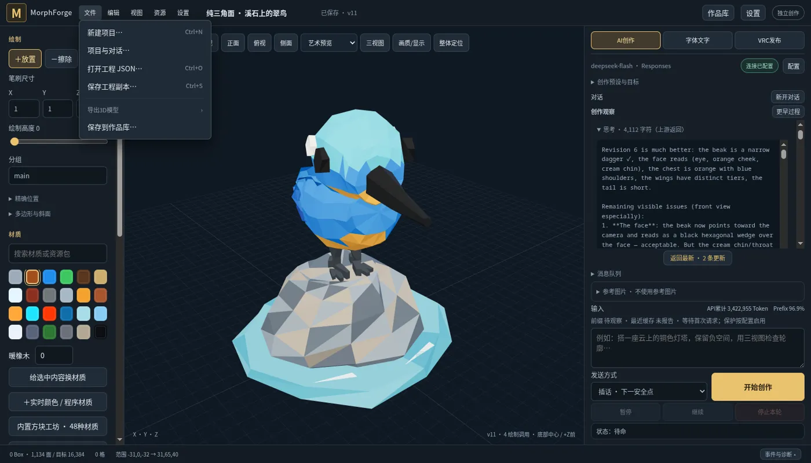

# 0.14.0：创作观察、桌面菜单与3D导出

2026-10-20，已构建并安装到gamepc独立的「MorphForge - 开发测试副本」。使用不可变版本目录；更新仅切换启动指针，已经运行的旧窗口与其数据保留。关闭并重新打开开发副本进入0.14.0。本轮未创建GitHub Release。

## 创作观察

右侧默认显示当前对话的创作过程，按模型响应整理为连续的阅读卡片：用户输入、可折叠的实际思考、正文、工具操作摘要和截图。流式片段会合并到所属响应，不再逐事件列卡；请求ID和call ID用于区分响应、打断与工具结果，避免正文在完成时重复。模型内容以安全的文字节点呈现，支持基本标题、粗体、行内代码和可折叠代码，不执行模型输出的HTML。

截图按artifact去重，显示视角、版本或历史参考身份，点击在应用内放大。工具默认显示操作与结果，错误直接可见；展开后读取参数和完整记录。历史思考展开时才按需读取完整响应，原始数据保留。图为此前真实DeepSeek过程的离线回放，本轮没有付费生成请求。

右侧保留输入、插话／打断／排队、暂停／继续／停止和缓存状态。预设/目标、消息队列、参考图默认折叠；手动Recipe、上下文compact、固定要求和对话文字备份移入设置。底部「事件与诊断」仍可按事件、运行、关键词或版本筛选，用于排查原始记录。

## 阅读位置与历史分页

- 只有停在底部时自动跟随；向上滚动、PageUp/Home/向上键立即脱离，显示「返回最新」。新事件不调用scrollIntoView，不牵动外层页面。
- 展开的思考、工具和当前阅读位置在增量更新时保留；载入更早过程按新增高度保持原位置。图片加载不再单独强制滚底。
- 默认过程仅查询当前对话；切回旧对话时，如日志尾部被其他对话占据，会有界向前寻找最近可展示记录，同时保留前向游标以继续接收新事件。
- 修复实际发现的中文日志问题：512KiB尾部分页可能从UTF-8字符中间开始。现在先按字节跳过不完整首行，再解析完整JSON行；不修改或删除原日志。加入确定从中文字符续字节开始的回归测试。

## 桌面菜单

左上角加入「文件、编辑、视图、资源、设置」。文件包含新建、项目与对话、打开JSON、保存副本、作品库保存，以及带子菜单的3D导出；编辑复用撤销/重做和选中内容操作；视图可适应、截图、设置画质和切换左右面板。支持菜单键盘方向导航和Escape，Ctrl+N/O/S对应新建、打开、保存副本，Ctrl+Shift+S打开模型导出。

这是共享前端中的桌面式菜单，网页和Tauri均可用；保留原来后端自动保存机制。「保存工程副本」下载可编辑工程JSON，3D模型导出不替代原工程备份。

## 3D模型导出

| 格式 | 保留内容 | 主要边界 |
|---|---|---|
| GLB / glTF 2.0 | 体素长方体、斜面、RGB三角面、法线、分组/材质分批、双面标志、PBR、透明/裁切、发光、内嵌六面图片与UV | 推荐通用交换；程序纹理使用基础色，图片动画取首帧；不携带Avatar逻辑或应用自定义Shader |
| OBJ ZIP | OBJ、MTL、分组名称、法线、UV、纯色和本地图片 | 解压后一起导入；透明、金属/粗糙度与双面效果取决于导入软件，不能保证等同GLB |
| PLY | 二进制网格、逐顶点RGB和材质透明度 | 图片折算平均色，无贴图/PBR/动画，也不保留像素alpha裁切 |
| STL | 二进制三角面与法线 | 仅几何，按毫米写出，Y轴向上；无颜色/贴图，也不保证可打印或单一封闭实体 |

导出同时覆盖带材质体素斜面与逐面纯色多边形，不把斜面重新变成完整立方体。统一转换为右手坐标、Y向上，并调整绕序，保持与工作台可见几何的对应。GLB/OBJ/PLY以米为单位；可设「每格对应米数」，默认读取工程cellSize（通常0.25），不包含Avatar的显示缩放。STL再换算为毫米。

导出整个工程，包含本地隐藏的分组，保留独立壳体和内部面，不做布尔并集或自动补洞。操作不改变工程revision、历史或模型上下文。每次最多500,000三角面；同一后端串行处理导出，读场景快照后在后台线程生成文件。

接口：`GET /api/export/model?format=glb|obj|ply|stl&cellSize=0.25`。OBJ返回ZIP；其余返回单文件。原`GET /api/export`仍返回完整工程JSON。

## 验证与交付

- Linux完整Rust回归211项通过；其后新增的会话隔离、摘要与UTF-8分页测试以时间轴专项10项验证通过。不是重复叠加专项中的既有测试计数。
- Node全部51项通过，包含流式片段合并、最终正文去重、工具/截图关联、插话、跨运行隔离、滚动和读取历史位置。
- 实际Chromium 20项通过：历史图文、旧对话查找/前向游标、脱离跟随、展开思考后阅读位置、图片放大、诊断列表滚动、菜单、真实GLB下载及新对话隔离；没有JavaScript/WebGL错误。
- Windows实际打包核心16项通过：导入1,134面翠鸟，导出四种格式，核对GLB accessor、OBJ/MTL、PLY颜色schema、STL长度/面数和revision不变，并验证打包Recipe子进程。Windows库测试82项通过，包含新分页与导出测试。
- Khronos glTF Validator `2.0.0-dev.3.10`：Linux翠鸟、Windows翠鸟、带六面贴图/长方体/两种斜面的样本均为0错误、0警告；贴图样本有一条未使用sampler的信息，不影响有效性。未将结构校验宣称为所有DCC软件的视觉兼容验证。
- 另外交叉核对STL二进制长度与面数、PLY面数、OBJ面数和材质/贴图文件。退化的斜面边面被省略，法线与绕序用正体积测试验证。
- 库Clippy检查通过；当前Rust 1.98对既有代码产生的六类lint仅在该检查命令中按名称排除，未为此改动无关实现，不宣称全仓all-targets无告警。

前期测试复现了展开历史后图片加载抢回滚动，已移除强制跟随并重跑。最初GLB多写了非MASK材质的alphaCutoff，已修正并重新通过官方校验。一次本地Recipe夹具失败来自测试期间重编译覆盖正在运行的调试二进制，后续使用独立不可变运行目录验证；Windows部署始终使用不可变目录。

证据：[浏览器检查](browser-validation.json)、[Windows核心](windows-runtime.json)、[安装记录](preview-install.json)、[格式交叉检查](format-validation.json)、`*-validation.json`中的官方GLB校验、`rust-tests.txt`、`timeline-tests.txt`、`node-tests.txt`。构建前后按[source-freeze.json](source-freeze.json)核对197个实际嵌入输入，Linux/Windows一致。
